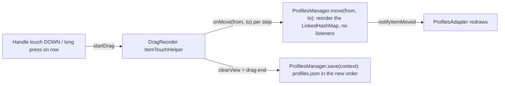

# Plan 08 — Super Artemis: move profiles up and down in the Profiles list (issue #4, its own PR)

> **Created:** 2026-10-30 · **Parent:** Super Artemis issue https://github.com/Arora-Sir/Super-Artemis/issues/4 (maintainer:
> "A PR for this would be very welcome"); owner's word in chat 2026-10-30 ≈22:25 +03:00 — «1 берем, делаем», «на все отдельный ПР делаем»
> · **Status:** 🔧 steps 1–5 done 2026-10-30 22:50 +03:00 (commit 8100a6d8 in the fork, run report testcases/reports/2026-10-30_super-artemis-profiles-reorder.md); PR — awaiting the maintainer · **Outbound:** a PR to `Arora-Sir/Super-Artemis` from branch `feature/profiles-drag-reorder` (pushed to
> the `kast` remote, like PR #8)

## Goal vector (Achieve)

The pain: the Profiles list keeps creation order, so a profile used every day can sit at the bottom and the user cannot move it.
Where we want to be: the user drags a profile by its handle (or a long press on the row) to any place in the list, and the order
survives an app restart.

## Acceptance criteria

1. Situation. Three profiles A, B, C in the list. Action. The user drags C by its handle above A. Result. The list reads C, A, B.
   Check. `adb shell input draganddrop` on Titan, then `UI_SERIAL=… node tools/ui.mjs texts` prints C before A before B.
2. Situation. The order C, A, B was set by a drag. Action. The app is force-stopped and opened again. Result. The list still reads
   C, A, B; the active profile stays the same. Check. `am force-stop` + relaunch + `tools/ui.mjs texts`; `run-as … cat
   files/profiles/profiles.json` lists the profiles in that order.
3. Situation. Unit level. Action. `ProfilesManager.move(2, 0)` on A, B, C, then save and reload. Result. C, A, B. Check.
   `gradlew :app:testNonRoot_gameDebugUnitTest --tests com.limelight.profiles.ProfilesManagerTest` green, and red on a `move` that
   does nothing (mutation).
4. Tapping a row still opens the editor; the radio, copy, edit and delete buttons work as before (walked on the device).

## Mechanism

`move` does not notify listeners on purpose: `ProfilesActivity.onProfilesChanged` calls `notifyDataSetChanged`, which would cancel
the drag in the middle. The order is saved once per drag, as the special keys manager does.

## Steps

- [x] 1. `ProfilesManager.move(int from, int to)` — rebuild the `LinkedHashMap` in the new order via `DragReorder.moveItem`.
- [x] 2. `row_profile.xml` — a drag handle (`ic_sa_drag_indicator`, description `@string/game_menu_editor_drag`) at the start of
      the row, as in `custom_key_row.xml`; no new strings.
- [x] 3. `ProfilesAdapter` — handle touch starts the drag; `ProfilesActivity` attaches `DragReorder` (long press on) and saves on
      drag end.
- [x] 4. Unit test in `ProfilesManagerTest` (order survives save + reload; move to the end), proven red on a no-op `move`.
- [x] 5. Build the debug APK, install on Titan and S21 FE, walk criteria 1, 2, 4; screenshots WebP; run report in `testcases/reports/`.
      Done on Titan only: S21 FE was not connected (2026-10-30, the owner on the road).
- [ ] 6. Commit in the fork branch, push to `kast`, open the PR (references #4), English text, screenshots.

## Risks

- (a) A drag cancelled by a data refresh mid-move — covered by `move` without listeners; observed on the device in step 5.
- (b) The active profile is kept by UUID, so a move cannot change it — checked in criterion 2.
- (c) Robolectric cannot drive a real drag — the UI part is checked on the device only.
