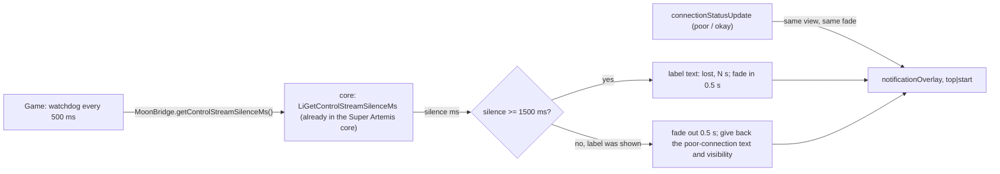

# Plan 09 — Super Artemis: the «connection lost» label over the last frame (issue #7, first of two PRs)

> **Created:** 2026-10-30 · **Parent:** Super Artemis issue https://github.com/Arora-Sir/Super-Artemis/issues/7 (maintainer: «Two
> separate PRs (HUD overlay first, auto-resume second)»); owner's words in chat 2026-10-30 ≈22:30 +03:00 — «2 - очень ценно, и
> нужно. И если владелец Super Artemis ничего не делал с виджетом-плашкой сверху, то делаем так, как я в KAST делал - слева вверху
> слева с анимацией фейда показа и сокрытие»; ≈23:53 — «4 делаем», «тестить можешь на титане» · **Status:** 🔧 steps 1–6 done 2026-10-31 00:20 +03:00 (commit aa0ffb90 in the fork, run report testcases/reports/2026-10-31_super-artemis-network-drop-label.md); PR — awaiting the maintainer ·
> **Outbound:** a PR to `Arora-Sir/Super-Artemis` from branch `feature/network-drop-label` (pushed to the `kast` remote)

## Goal vector (Achieve)

The pain: when the network drops, Super Artemis keeps the session alive for the grace period (the core timeout ported from
KAST), but the screen shows a frozen picture with no word about it; the user cannot tell a frozen stream from a lost network.
Where we want to be: within 1.5 s of silence from the host a label in the top left corner says that the connection is lost
and counts the seconds; when the host answers again the label fades away; the existing «poor connection» label uses the same
place and the same fade.

## Acceptance criteria

1. Situation. A stream of Desktop on Titan. Action. The host's network is cut for 20 s (`tools/droprun.ps1 -Seconds 20 -MidShotAt 10`).
   Result. The mid-drop screenshot shows «Connection lost, waiting for the network… N s» in the top left corner over the
   last frame; after the network returns the label is gone and the stream goes on. Check. The screenshot pair and the logcat
   lines `NetworkDrop silence start` / `NetworkDrop held elapsed=…` of the run.
2. Situation. The same stream. Action. Nothing (no drop) for 60 s. Result. No label appears. Check. Logcat has no
   `NetworkDrop silence start` line (control case).
3. Situation. A drop longer than the grace period (default 30 s). Action. The network is cut for 40 s. Result. The label
   counts up to the end, then the existing «connection terminated» dialog shows. Check. Logcat and the screenshot after 35 s.
4. The label fades in and out over 0.5 s; picture-in-picture still hides it (checked by reading the code path, PiP is not
   driven on the device).

## Mechanism

The core part is already merged in Super Artemis (`LiGetControlStreamSilenceMs`, submodule `Arora-Sir/moonlight-common-c`
`e7b0f06`); this PR adds the JNI bridge, the watchdog in `Game`, the fade and the position.

## Steps

- [x] 1. `simplejni.c` + `MoonBridge.getControlStreamSilenceMs()` — the bridge to the existing core function.
- [x] 2. `Game`: watchdog runnable started in `connectionStarted`, stopped by the existing `removeCallbacksAndMessages`; the
      label text with the seconds; log tag `NetworkDrop`.
- [x] 3. `Game`: fade helper (0.5 s) used by the watchdog and by `connectionStatusUpdate`; the poor-connection text is given back
      after the outage label.
- [x] 4. `activity_game.xml`: `notificationOverlay` to `top|start` with 10dp margins.
- [x] 5. `values/strings.xml`: `network_drop_waiting`; Russian text after PR #8 is merged (PR #8 reorders `values-ru`).
- [x] 6. Build, unit suite, install on Titan, runs for criteria 1–3, run report, CHANGELOG, PR.

## Risks

- (a) The owner's own stream over the host's Tailscale is cut by the drop run — warn him before each run.
- (b) The debug build on Titan knows the host by its home address only — add the Tailscale address as in the profiles run.
- (c) A label that never leaves after a recovery — criterion 1 reads the end of the label in the screenshot after the drop.
