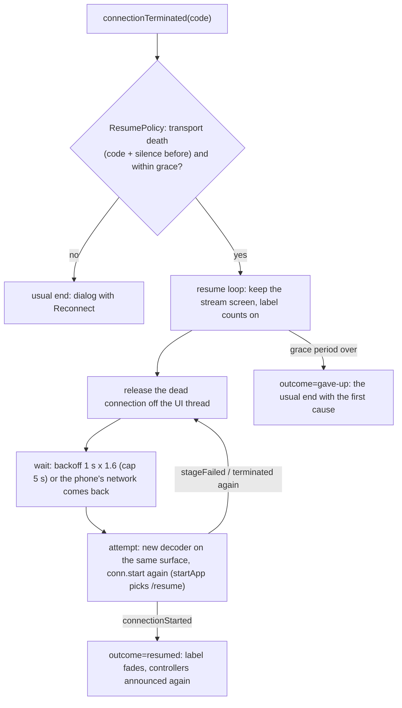

# Plan 10 — Super Artemis: auto-resume within the grace period (issue #7, second PR)

> **Created:** 2026-10-31 · **Parent:** Super Artemis issue https://github.com/Arora-Sir/Super-Artemis/issues/7 (maintainer: «auto-resuming
> during the grace period completes the KAST port nicely», «Two separate PRs (HUD overlay first, auto-resume second)»); owner's word in
> chat 2026-10-31 ≈00:35 +03:00 — «1 делаем, раз крупное и ждут, раз в каст мы это сделали», «по каст пока не работаем, делаем Супер
> Артемис»; source design: KAST plan 06 (F3) and its runs `testcases/reports/2026-09-26_F3_resume.md` · **Status:** 🔧 steps 1–4 done 2026-10-31 00:33 +03:00 (fork commit `a7b7d335`
> on `feature/auto-resume`, pushed to `kast`, WIP — no PR); step 5 partly — runs 2026-10-31 00:49–00:59 on Titan, see «Runs so far» ·
> **Outbound:** a PR to `Arora-Sir/Super-Artemis` from `feature/auto-resume`, stacked on PR #11 (`feature/network-drop-label`)

## Goal vector (Achieve)

The pain: when the transport dies inside the grace period (the host let the client go first, or the client's address changed),
Super Artemis shows «Соединение разорвано» and the user presses Reconnect, which starts a new stream screen. Where we want to be:
the stream screen stays, the label keeps counting, Super Artemis resumes the session on the host by itself as soon as the host
answers, and only past the grace period the usual dialog shows.

## Acceptance criteria

1. Situation. A stream on Titan; the client's control timeout shorter than the grace period (test build: 10 s, grace 30 s). Action.
   The host's network is cut for 20 s. Result. No dialog; the label counts on; the stream comes back after the network does.
   Check. client log `ResumeLoop: start cause=-1`, `attempt=N … failed`, `outcome=resumed`; screenshot after the run shows the stream.
2. Situation. The same. Action. A 45 s cut. Result. Attempts fail until 30 s, then the «connection terminated» dialog with
   Reconnect. Check. `outcome=gave-up`, screenshot with the dialog.
3. Situation. A stream. Action. The user ends the session from the Quick Menu. Result. No attempt starts. Check. no `ResumeLoop`
   line after the quit.
4. Unit: the end class table (0 and -102…-104 final; -1, -101 and positive codes resume only after a silence) and the backoff
   (1 s × 1.6, ±20 %, capped) — `ResumePolicyTest`, proven red on a broken rule.
5. The screens of the resume (label during attempts, the stream back, the dialog after the grace period) are shown to the owner
   before the PR goes out (memory: show UI before a PR).

## Mechanism

FORK: scope of this PR — loop only | loop + codec kept across attempts (no black frame at the restart) | loop + reason dialog +
setting · price of error: a large first PR is harder to review and merge; without the kept codec the picture may go black for a
moment when the stream comes back · consulted: the maintainer's request (two small PRs), KAST's F3 history (the black flash was
seen by the owner and fixed later, plan 06 step 10). Chosen: loop only; the black flash is checked on the device and shown to the
owner before the PR — if he rejects it, the kept codec joins this PR.

## Steps

- [x] 1. `com.limelight.session.ResumePolicy` (pure: end class, within grace, backoff) + `ResumePolicyTest`, red on a mutant.
- [x] 2. `Game`: decoder construction moved into `createDecoderRenderer()` (onCreate and every attempt use it).
- [x] 3. `NvConnection.start`: a fresh remote-input key and key id for every start (one key with restarted IV counters across two
      sessions would let an observer forge control messages — KAST judge S2).
- [x] 4. `Game`: the resume loop — termination branch, attempts, backoff and network callback, give-up, cancel on leaving;
      `stageFailed`, `connectionStarted`, `displayMessage` guards for attempts (an attempt that outlives the loop never reaches the
      start spinner — KAST bug 07, a crash); controllers announced again after a resume.
- [ ] 5. Build, unit suite; a local test build with the client control timeout at 10 s (not committed); runs for criteria 1–3 on Titan.
- [ ] 6. Show the screens to the owner; CHANGELOG; run report; PR.

## Risks

- (a) The host must keep the app running after it drops the client (Vibepollo does: «Session pausing», /resume) — checked in run 1.
- (b) An attempt in flight when the loop ends — handled as in KAST (left to finish, disposed of where it reports).
- (c) The owner's MacBook stream shares the host — solved 2026-10-31 00:48: `channels = 2` in `sunshine.conf` (owner: «разрешаю два
  канала, да»; backup `sunshine.conf.bak-20261031-channels`); the drop is Titan's Wi-Fi off, his stream is not touched.

## Runs so far (2026-10-31, Titan, test build with the client control timeout at 10 s; drop = Titan's Wi-Fi off by a script on the tablet)

| Time | Drop / grace | Result | Evidence (private) |
|---|---|---|---|
| 00:49:32 | 20 s / 30 s | death at 10.1 s; attempts 1–2 failed (no network); attempt 3 reached the host at 28 s and connected at 30.4 s, just past the grace: gave up, the usual dialog; the late attempt was stopped, no crash | `C:\Android\private\evidence\20261031-004901-wifi20-resume\` |
| 00:51:57 | 20 s / 60 s | **resumed**: `outcome=resumed attempt=3 elapsed=32046`, the stream went on | `…\20261031-005125-wifi20-resume60\` |
| 00:57:58 | 20 s / 60 s, with screen recording; the owner stopped the run | gave up at 60 s: Titan's link through Tailscale took > 40 s to come back — no attempt request reached Vibepollo 00:58:09–00:58:55; attempt 1 hung 21 s on HTTPS («unexpected end of stream»), attempt 2 «Read timed out», attempt 3 no connect in 5 s; frames and audio were already dropping before the cut | `…\20261031-rec-interrupted\client_full.log`; recording `/sdcard/sa_resume.mp4` still on Titan |

The owner watched the resume (chat 2026-10-31 ≈01:00 +03:00): «выглядело четко, только они зачем-то виджет стартинг стримминг прямо в
центре кадра показывают - оно будет мешать», «я бы это тоже вынес в верхний левый виджет-плашту состояний».

## Next — the next session starts here

- [ ] 5a. Short timeouts for attempts: one attempt must not eat 21 s of the grace on a hung HTTPS read. Port KAST's short probe for
      resume attempts (`NvConnection.setKastResumeAttempt` → `getServerInfo` with the 3 s connect timeout) and check the read timeout.
- [ ] 5b. The «starting stream» overlay (`streamStartingOverlay`, centre of the frame) moves into the top-left status label — on a resume
      and, by the owner's word, as the rule; show him the screens before the PR.
- [ ] 5c. Repeat 20 s / 60 s on a steady Wi-Fi; a 75 s run for the give-up; the user ending the session during a resume (criterion 3).
      Test build: in `Game.java` replace `.setControlPeerTimeoutMs(prefConfig.networkGraceSeconds * 1000)` by `10000` locally, never commit;
      the run script is the scratch `wifi_drop.sh` pattern (Titan Wi-Fi off/on by `cmd wifi set-wifi-enabled` in a `nohup` on the tablet).
