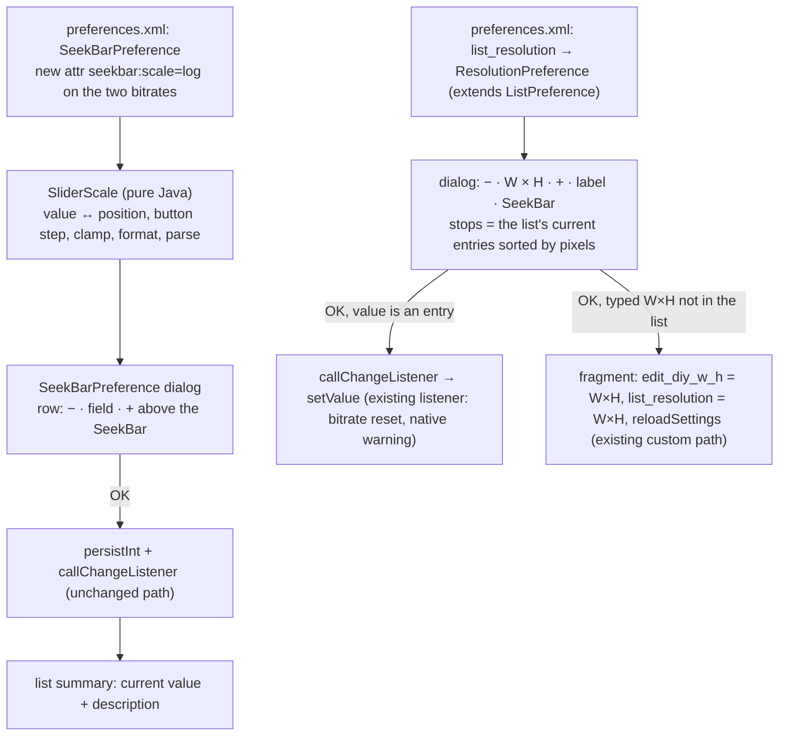

# Plan 11 — Super Artemis: «−», field and «+» in every slider dialog, a log bitrate bar, and a two-field resolution dialog

> **Created:** 2026-11-06 · **Parent:** `ideas/16` (variant A), `ideas/17` (variant R2), `interviews/interview_003_sliders_dialog_or_list.md`
> (owner 2026-11-06 09:54: Q1 A — in the dialog, Q2 A — the app's own resolution list); owner's word 09:43 «делаем», 09:44 «и красиво ПР
> оформим, со скриншотами, как мы любим» · **Status:** 🔧 2026-11-06 10:25 — steps 1–5 done (fork commit 3ad4cbac; criteria 1–6 passed on Titan; owner's look fixes 10:03–10:19: mockup styling, bar spacing and colour, values in the list for resolution and frame rate); step 6 — the owner's word on the page `reports/sa-sliders/before_after.html` ·
> **Outbound:** one PR to `Arora-Sir/Super-Artemis` from branch `feature/sliders-plus-minus` (base `unified-main` = tag `v1.1.0`),
> screenshots before/after; shown to the owner BEFORE the PR (EXP-0010); the same later in KAST

## Goal vector (Achieve)

The pain (owner's words, `ideas/16`, `ideas/17`): 2 or 3 Mbps cannot be set without «millimetres of the slider»; a slider has no
fine «−»/«+» and no field to type a number; the resolution is typed as «1920x1080» with a Latin «x» while the keyboard is Russian.
Where we want to be: every slider dialog of Super Artemis has «−», a centred number field and «+» above the bar; the bitrate bar is
logarithmic; the resolution dialog has two number fields with a fixed «×», «−»/«+» stepping through the app's resolution list, and a
bar over the same list.

## Acceptance criteria

1. Situation. Bitrate 10 Mbps on Titan, Super Artemis debug build of this branch. Action. The user opens «Битрейт видео» and presses
   «−» 10 times, then OK. Result. The field reads 2,5 after the presses; the list line under «Битрейт видео» starts with «2,5 Мбит/с».
   Check. `ui.py labels` after OK contains `2,5 Мбит/с`; screenshot `after_bitrate_dialog.webp`.
2. Situation. The same dialog. Action. The bar is dragged to its middle. Result. The field reads a value between 10 and 15 Mbps
   (the geometric middle of 0,5–300 is ≈12). Check. `labels` of the dialog.
3. Situation. The same dialog. Action. «3» is typed into the field and the keyboard's Done is pressed. Result. Field 3,0, the bar moves
   to ≈28 % of its length (ln 6 / ln 600). Check. `labels` + screenshot.
4. Situation. Resolution 1080p. Action. The user opens «Разрешение» and presses «+» once. Result. Fields 2560 × 1440, label «1440p»;
   OK writes `list_resolution=2560x1440`. Check. `adb shell run-as … cat shared_prefs/*.xml | grep list_resolution`.
5. Situation. The resolution dialog. Action. 1680 and 1050 are typed into the fields, OK. Result. Label «Пользовательский» under the
   fields before OK; after OK the list holds the custom entry and `list_resolution=1680x1050`, `edit_diy_w_h=1680x1050`. Check. prefs.
6. Control case. A linear slider (network grace 10–60 s, step 5): «+» from 30 gives 35; the bar has 10 positions. Check. `labels`.
7. Hygiene: `SliderScaleTest` (9) + the existing unit suite; no new failures beyond the two known Windows `BackupRestoreTest` ones.

## Mechanism

## Steps

- [x] 1. `SliderScale` + `SliderScaleTest` (log 0,5–300 Mbps with the ladder 0,5/1/2/5/10, zero stop of the metered bitrate, linear,
      locale format, parse of «,» and «.»).
- [x] 2. `SeekBarPreference`: the row «−» · field · «+», the bar on `SliderScale`, attr `seekbar:scale`, summary with the value.
- [x] 3. `preferences.xml`: `seekbar:scale="log"` on `seekbar_bitrate_kbps` and `seekbar_metered_bitrate_kbps`.
- [x] 4. `ResolutionPreference` + `preferences.xml` class swap + `StreamSettings` hook for a typed custom resolution.
- [x] 5. Build, unit suite, install on Titan, criteria 1–6 by `ui.py`, screenshots before/after, run report.
- [ ] 6. The page for the owner (before/after in Chrome) → his word → CHANGELOG → PR with screenshots.

## Risks

- (a) Profiles and quick presets write the same keys (`PresetActions` reads `seekbar_bitrate_kbps`) — the stored value stays kbps,
  only the dialog changes; criterion 1 reads the stored value through the list line.
- (b) A typed resolution not in the list goes through `reloadSettings`, which rebuilds the screen — the dialog must be dismissed first.
- (c) TV remote (D-pad) on a log bar: key increment 10 positions (1 % of the bar) — not driven on a device here, read in the code.
