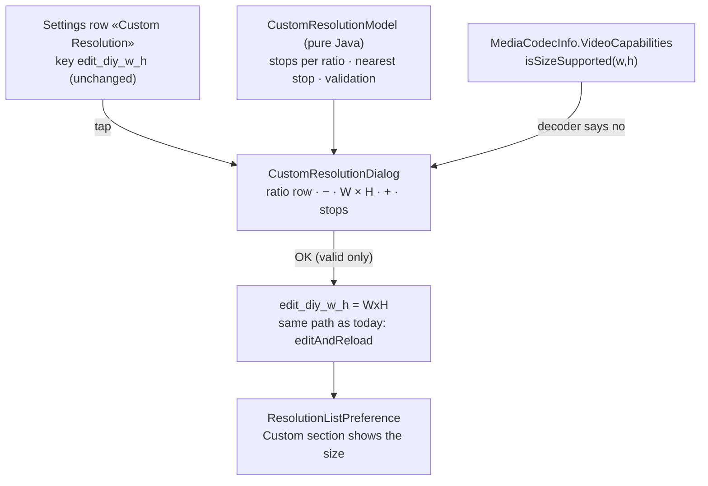
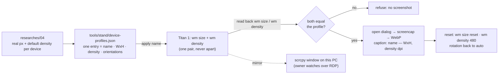

# Plan 12 — Super Artemis: the Custom Resolution dialog (V3.2), slider ends off the dialog edges, and the device-profile stand

> **Created:** 2026-11-06 · **Parent:** `ideas/17` (V3.2 compact, owner's choice), issue https://github.com/Arora-Sir/Super-Artemis/issues/14
> (maintainer's reply: direction approved, ratio set approved, «Looking forward to your PR»); owner's word 2026-11-06 ≈23:20 «Делаем!»
> · **Status:** 📝 2026-11-06 23:31 — plan written; device recon `researches/04` in flight
> · **Outbound:** two PRs to `Arora-Sir/Super-Artemis` (base `unified-main`), each shown to the owner on one page BEFORE `gh pr create`
> (EXP-0010): PR-A slider ends, PR-B Custom Resolution dialog; device screenshots in PR-B

## Goal vector (Achieve)

The pain: the Custom Resolution row is a text field split on a Latin «x» (`StreamSettings.java`, `split("x")`): a Cyrillic «х» gives
«An error occurred», the letter keyboard opens for digits, and a full-screen size for a 19.5:9 phone is computed by hand. In the merged
slider dialogs the bar runs from edge to edge (`StepperViews.barParams` margins 0, dialog layout padding 6 px), so the thumb at 0 or at
max nearly touches the dialog edge — owner 2026-11-06: «их правые и левые концы слишком близко к краям диалогов … некрасиво, нужно будет
чуть-чуть подвинуть к центру».
Where we want to be: the dialog of issue #14 (ratio row · «−» · W × H · «+» · labelled stops · validation), the bar ends inset from the
dialog edges, and both shown on ~10–12 real device screen configurations, from square to foldables and 14" tablets, in portrait and landscape.

## Acceptance criteria

1. Situation. Titan, debug build of PR-B, profile «S24 Ultra» (1080×2340 @ 450). Action. The user opens Custom Resolution. Result. The
   ratio row shows Native · 16:9 · 16:10 · 21:9 · 4:3, Native selected, fields hold the saved size, the chip names the stop.
   Check. `UI_SERIAL=… node tools/ui.mjs texts` lists the five ratio labels and the chip text; screenshot `s24_port_open.webp`.
2. Situation. The same dialog. Action. «16:9» is tapped, then «+» once from 1080p. Result. Fields 2560 × 1440, chip «16:9 · 1440p».
   Check. `ui.mjs texts`.
3. Situation. The same dialog. Action. «1921» is typed into the width. Result. OK disabled, the field red, one line names the reason (odd).
   Check. `ui.mjs texts` shows the reason line; `uiautomator dump` shows OK `enabled="false"`.
4. Situation. The same dialog. Action. 2344 × 1080 typed, OK. Result. `edit_diy_w_h=2344x1080`; the picker's Custom section lists it.
   Check. `adb shell run-as com.mohitarora.superartemis.debug cat shared_prefs/*_preferences.xml | grep edit_diy_w_h`.
5. Situation. Each of the ~10–12 device profiles, portrait and (where the device rotates) landscape. Action. The dialog is opened.
   Result. No control is clipped, the ratio row fits or wraps by design, the slider labels do not overlap. Check. one WebP per state in
   `reports/sa-custom-resolution/devices/`, read by the agent before the owner sees it.
6. Situation. PR-A build, bitrate dialog, thumb at 0 and at max. Action. screenshot. Result. the thumb's outer edge stands at least
   the title indent (≈24 dp) from the dialog edge — the bar ends line up with the description text. Check. pixel measure on the WebP.
7. Control case. The same profile with the PR-A change reverted: the thumb at max touches the edge zone again (measured < 12 dp).
8. Hygiene: the existing unit suite + a new pure-Java test for the ratio stops and validation (`CustomResolutionModelTest`).

## Mechanism — the dialog (PR-B)

## Mechanism — the device-profile stand (agent's tooling, not in any PR)

## Steps

- [ ] 1. **Recon of real displays** — `researches/04_device_display_specs.md` (background agent, sources per number; owner's words:
      «ищем в сети настоящие данные плотности, разрешения, соотношения реальных девайсов», ~10 devices «от квадратных до фолдов, до
      флипов, маленьких, гигантов на 14 дюймов»; flips — inner unfolded screen only). Exit: every profile row carries a URL for its px and its density.
- [ ] 2. **Stand** — `tools/stand/device-profiles.json` + `tools/stand/stand.mjs apply <name> [port|land] | shoot <name> <label> | reset | list`.
      Resolution and density are one record and are applied, read back and captioned together (owner: «разрешение и плотность - две
      неразрывные переменные!»). Titan's own state saved before the first apply and restored by `reset`: size = panel, density override 480,
      `accelerometer_rotation 1`. Exit: `apply` of one profile, read-back equal, `reset` returns `Override density: 480` and no size override.
      Row in `HOUSE_RULES.md` → Tools.
- [ ] 3. **PR-A, slider ends** — branch `feature/slider-ends-inset` from `origin/unified-main`; one change in `StepperViews.barParams`
      (side margins so the bar ends line up with the title/description indent). Build, install, screenshots on three profiles
      (phone portrait, phone landscape, tablet landscape), before/after. Exit: criteria 6–7.
- [ ] 4. **PR-B, the dialog** — branch `feature/custom-resolution-dialog` from `origin/unified-main`. `CustomResolutionModel` + test;
      `CustomResolutionDialog` reusing `StepperViews`; the row `edit_diy_w_h` opens it instead of the `EditTextPreference` text dialog;
      new strings (recommended line, four validation reasons) into every `values-*` (`tools/l10n/`). Exit: criteria 1–4, 8.
- [ ] 4b. **Owner's look check BEFORE the sweep** — the working dialog on Titan (2–3 profiles, the four states) on one page in Chrome
      on this PC; his remarks applied, round after round; the sweep starts only after his agreement. [OWNER] «прежде чем для ПР будем
      снимать скриншоты диалога разрешения на разных девайсах и языках - покажешь мне, как он получится, согласуем. Может будут правки
      от меня» · «только когда согласуем. сделаем его красиво - тогда будем снимать скриншоты для ПР» · chat 2026-11-06 ≈23:50.
- [ ] 5. **Device sweep** (languages: English first; 1–2 shots each in Russian, Spanish, French, German — owner 2026-11-06 ≈23:39–23:40) — every profile, portrait + landscape (tablets: landscape two-pane settings first), the four states of the
      dialog (Native open, 16:9 stop, typed custom, validation error). Read each WebP; a clipped control is a defect fixed before the show.
      Exit: criterion 5.
- [ ] 6. **Show the owner** — one page in a new Chrome window on this PC, all devices, before/after for PR-A; wait for his word.
- [ ] 7. **PRs** — after the owner's word: push to `kast`, `gh pr create -R Arora-Sir/Super-Artemis` ×2, screenshots captioned by the
      device name with its screen pair (see the caption rule below); then STATUS, run reports in `testcases/reports/`.

## Caption rule for the device screenshots

[OWNER] «то, чт мы будем притворяться этими девайсами - мейнтейнеру не пишем.» · «СНИМКИ УВИДИТ!!! НО НЕ ПИШЕМ, ЧТО ЭТО СИМУЛЯЦИЯ, А
ПРОСТО ПИШЕМ Xiaomi 16» · chat 2026-11-06 ≈23:27–23:28.
1. Each screenshot is captioned with the device name and its screen pair: «Galaxy S24 Ultra — 1080×2340, 450 dpi».
2. The PR text carries no word about how the screenshots were produced.
3. The PR carries a «Screenshots» list: one line per screenshot — device name · screen pair · orientation. [OWNER] «а скриншотов
   список напишешь на каких девайсах сняли!» · chat 2026-11-06 ≈23:39.
4. The PR text has no «Tested on» line at all. [OWNER] «проверяно на можешь НЕ ПИСАТЬ!» · chat 2026-11-06 ≈23:38.

## Risks

- (a) `wm size` larger than the panel (S24 Ultra QHD+ 1440×3120, Tab S10 Ultra 1848×2960) — the panel downscales; use the device's
  default resolution mode or a pair scaled with the same factor on px and density (same dp), named as such in the profile.
- (a) Leaving Titan in a foreign profile — `reset` runs in a `finally`; the restore values are written in step 2 and checked.
- (b) Wireless `adb` drops after `wm size` (the display reconfigures) — reconnect `192.168.1.3:<port>`; the scrcpy window restarts.
- (b) The maintainer's `unified-main` moves on during the work — rebase before each PR.
- (c) Cut-outs, rounded corners and One UI fonts of real devices are not reproduced — the caption names the screen pair only.

## Decisions made without the owner

Filled at closing.
