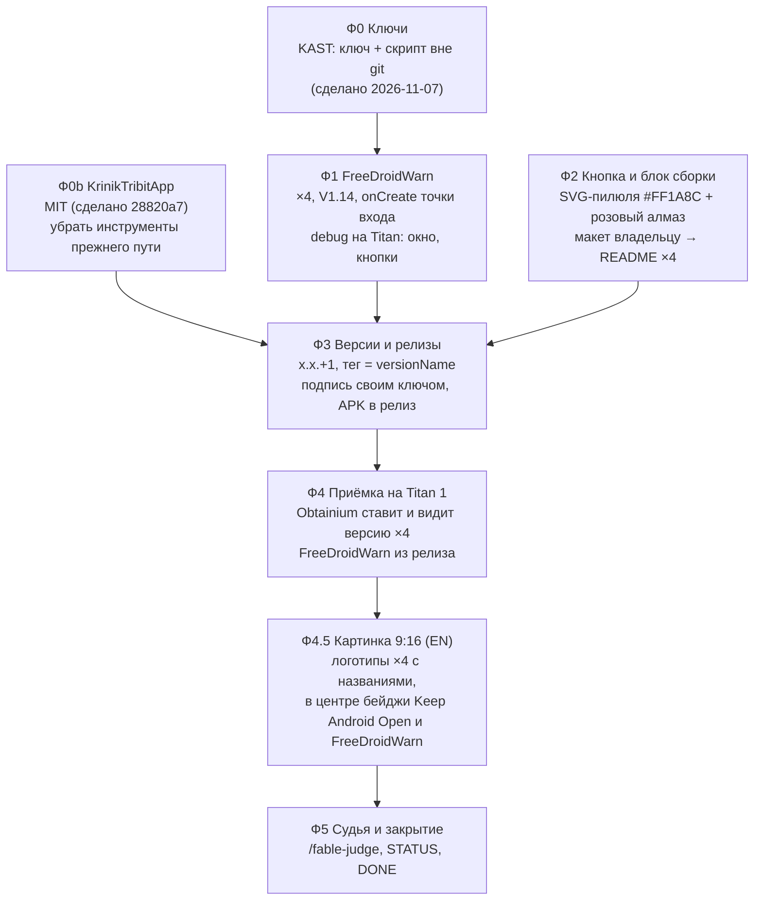

# 13 EPIC — Свобода дистрибуции: FreeDroidWarn + Obtainium + релизы x.x.+1

Слова владельца — `ideas/18_distribution_freedom_android_apps.md`. Разведка — `researches/05_distribution_freedom.md`.
Проекты: **KAST, KrinikCam, KARTUN, KrinikTribitApp** (клоны `D:\work\ai_sandbox\{KAST,KrinikCam,KARTUN,KrinikTribit}`).

## Вектор цели

Боль: Google с 2026/2027 требует личные данные разработчика для любых APK на сертифицированных устройствах; наши приложения
раздаются «скачай APK руками» без обновлений, а KrinikCam на GitHub подписан случайным debug-ключом CI.
Куда: каждое из четырёх приложений честно предупреждает пользователя (FreeDroidWarn), ставится и **само обновляется через
Obtainium** по одной розовой кнопке в README, подписано своим постоянным ключом, и README говорит, как собрать его самому.

## Критерии приёмки

- **К1** · Ситуация: на Titan 1 стоит релиз из GitHub · Действие: первый запуск · Результат: окно FreeDroidWarn на языке системы; OK — больше
  не показывается до следующего versionCode; «Подробнее»/«Решение» не роняют приложение · Проверка: снимок WebP + logcat без FATAL, ×4 приложения.
- **К2** · Ситуация: README проекта на GitHub · Действие: нажать розовую кнопку Obtainium на телефоне с Obtainium · Результат: Obtainium
  открывает карточку приложения с верными id/автором/именем и находит последнюю версию x.x.+1 · Проверка: снимок Obtainium на Titan, ×4.
- **К3** · каждый релиз: тег `vX.Y.Z` = `versionName` `X.Y.Z`; в релизе APK, подписанный своим ключом (`apksigner verify --print-certs`
  ≠ `CN=Android Debug`); versionCode больше прошлого релиза · Проверка: вывод apksigner + `gh release view`, ×4.
- **К4** · README каждого проекта: кнопка Obtainium в стиле `#FF1A8C` с розовым алмазом (EN и RU-раздел), блок «Как собрать» по одному
  шаблону · Проверка: макет показан владельцу до коммита; рендер README на GitHub снят.
- **К5** · ключи релиза вне git у всех четырёх (`git check-ignore`), копия у владельца · Проверка: вывод check-ignore.

## Фазы

Развилка по KrinikTribitApp решена владельцем 2026-11-07: «Предлагаю MIT» и «убрать» инструменты прежнего пути.

**Ф0b — что убирается из публичного KrinikTribitApp** (путь «патчить официальный APK»; отслеживаемые файлы на 2026-11-07):
`build.sh`, `patches/` (apply.py, add_dex.py, java/ ×8, assets/ ×3), `tools/recon/` (×18), `tools/gen_r.py`, `tools/kotlin_defaults.py`,
`tools/native_src_count.py`, `tools/native_src_guard.py`, `tools/decompile_clean.py`, `tools/test_decompile_clean.py`; ссылки на них в
README / HOUSE_RULES / картах проекта переписать. **Остаются** инструменты нового приложения: `tools/fetch_speaker_images.py` и
`tools/devices/` (каталог колонок и фото — решение владельца 2026-10-16 «зашиваем в наш апп»), `tools/screen_profile.py`, проверки.
Файлы уходят из дерева; в истории git они остаются (переписывать историю публичного репозитория — только по отдельному слову владельца).

Порядок и почему:
- **Ф0** первым: без ключа нет подписанного релиза (сделано: `KAST/keys/`, `tools/make-release-key.py`, подпись в `app/build.gradle`).
- **Ф1 и Ф2 независимы** (код приложений vs README) — идут параллельно; Ф2 упирается в показ макета владельцу (правило «интерфейс — до PR»).
- **Ф3 после Ф1 и Ф2:** релиз должен уже содержать FreeDroidWarn, а README — вести на него; кнопка Obtainium без релиза ведёт в пустоту.
- **Ф4** — на настоящих релизах, не на debug: проверяется именно то, что получит пользователь.

## Ворота

| Фаза | Вход | Закрытие |
|---|---|---|
| Ф1 | клоны чистые по нашим файлам | debug-сборка ×4 зелёная; на Titan окно показано, OK запомнен, «Подробнее»/«Решение» без падения; снимки WebP |
| Ф2 | бренд-цвета из разведки | владелец одобрил макет кнопки и блока; README ×4 закоммичены; рендер на GitHub проверен |
| Ф0b | слово владельца «убрать» | файлы прежнего пути не в `git ls-files`; debug-сборка KrinikTribitApp зелёная; ссылок на них в README нет |
| Ф3 | Ф0b, Ф1, Ф2 закрыты | релиз ×4: тег = versionName, APK подписан своим ключом (apksigner), versionCode вырос |
| Ф4 | релизы опубликованы | К1–К3 на Titan по каждому приложению, снимки |
| Ф5 | Ф4 | вердикт судьи VERIFIED, STATUS, `DONE` в имени файла |

## Скелеты фаз (операционный план пишется к началу фазы)

- **Ф1 FreeDroidWarn** — JitPack в репозитории (у KARTUN и KrinikTribit добавить), `implementation 'com.github.woheller69:FreeDroidWarn:V1.14'`,
  вызов в `onCreate`: KAST `PcView.java`, остальные `MainActivity.kt`; защитить от #45 (нет браузера); commit + push в каждый репозиторий.
- **Ф2 Кнопка и блок** — `docs/get-it-on-obtainium-{en,ru}.svg` (пилюля по образцу `KARTUN/docs/download-en.svg`, розовый алмаз, подпись
  источника и GPL-3.0 алмаза); глубокая ссылка с JSON приложения; шаблон блока «Как собрать»; макет — страница в новом окне Chrome на этой машине.
- **Ф3 Версии и релизы** — KAST 20.2.6→20.2.7 (code 58), KrinikCam 0.9→0.9.1 (`version.json`, CI больше не подписывает debug-ключом),
  KARTUN 1.0→1.0.1 (`versionName` чистый `1.0.1`), KrinikTribitApp 0.1→0.1.1 (code 2, первый релиз); сборка релиза своим ключом,
  `gh release create vX.Y.Z` с APK; имена APK под фильтр Obtainium.
- **Ф4.5 Картинка 9:16** (владелец 2026-11-07: «В конце работы сверстать…») — вертикальная 9:16 на английском: в центре бейдж организации
  Keep Android Open (https://keepandroidopen.org) и бейдж FreeDroidWarn, вокруг — логотипы KAST, KrinikCam, KARTUN, Krinik Tribit с
  названиями под ними. Вёрстка HTML → снимок **WebP** (PNG не писать); официальные бейджи и условия их использования — с сайтов
  keepandroidopen.org и github.com/woheller69/FreeDroidWarn; показать владельцу на этой машине.
- **Ф4 Приёмка** — Titan 1 по Wi-Fi: поставить Obtainium, по кнопке из README добавить каждое приложение, поставить, увидеть окно FreeDroidWarn.

## Риски

- KrinikCam: у тех, кто ставил 0.9 (debug-ключ CI), 0.9.1 поверх не встанет — разовая переустановка; сказать в заметках релиза.
- KARTUN: смена `versionName` с «1.0 (N)» на `1.0.1` убирает номер сборки из строки версии в приложении — номер остаётся в versionCode.
- KAST: четыре ABI-APK с одним versionCode — Obtainium без фильтра спросит, какой ставить; фильтр в глубокой ссылке.
- KAST на паузе (владелец 2026-11-06), но входит в список владельца — делаем.
- FreeDroidWarn #49: окно показывается и на системах без Google — принимаем как есть (текст библиотеки фиксирован).

## Ход фаз (2026-11-07)

- [x] **Ф0** ключ KAST `keys/` вне git, `tools/make-release-key.py`, подпись из `keys/release.env` (`eacdf4a0`).
- [x] **Ф0b** KrinikTribitApp: MIT (`28820a7`); инструменты прежнего пути убраны, документы и README про сборку нашего приложения (`7881dbc`).
- [x] **Ф1** FreeDroidWarn V1.14 ×4 (`9603064` KARTUN, `15f6cf6` KrinikTribitApp, `00b436a` KrinikCam, `3afa2200` KAST); FDW-0…7 pass ×4 —
      `testcases/reports/2026-11-07_distribution-fdw.md`; судья: проверено с оговорками (FDW-8 не прогонялся).
- [x] **Ф2** кнопка Obtainium утверждена («вот теперь идеально»), блок «Build it yourself» ×4, шапка и розовая заставка KAST, новый логотип
      KAST (утверждён «утверждено»), «Short name» убран у KrinikCam.
- [x] **Ф3** релизы: KAST `v20.2.7`, KrinikCam `v0.9.1`, KARTUN `v1.0.1`, KrinikTribitApp `v0.1.1` — свои ключи, тег = versionName.
- [x] **Ф4** Titan: релизы ставятся (KARTUN поверх 1.0), FreeDroidWarn в релизах, Obtainium по кнопке из README ×4 «Установлена/Последняя» —
      `testcases/reports/2026-11-07_distribution-releases-obtainium.md`. BLD-1 (чистый клон по README) pass ×4; установка самим Obtainium — Krinik Tribit (`installerPackageName=dev.imranr.obtainium.fdroid`).
- [x] **Ф4.5** картинка 9:16 `reports/distribution/final/kast-family-9x16.webp`.
- [x] **Ф5** независимый судья по эпику: VERIFIED WITH CAVEATS; найденное исправлено (установка самим Obtainium — Krinik Tribit; ключ `matchGroupToUse` в ссылке KAST; значки версий KrinikCam/KARTUN; `release.yml` KrinikCam — только ручной запуск и только со своим ключом из секретов; `bash build.sh` в навыках KrinikTribitApp; дубли файлов KAST); STATUS; DONE.

**Статус: ✅ DONE 2026-11-07.** Оговорки, оставленные как есть: FDW-8 (язык окна принудительно) не прогонялся; REL-5 показан подписями, не на устройстве; обновление нажатием в Obtainium (не adb) — проверится на следующем релизе; ссылка в приложении KAST 20.2.7 ещё с опечаткой `matchGroutToUse` (ключ просто игнорируется, исправлено в коде к следующему релизу).

## Решения, принятые без владельца

[AI] по мандату «работай автономно» и по ходу работ (каждое записано и обратимо):

- Ключ KAST и пароль — в одной папке `keys/` (а не в корневом `.env`, где лежит PIN стенда), чтобы владелец копировал одну папку.
- «x.x.+1» понято как последняя цифра (0.9 → 0.9.1); у KrinikCam и KARTUN `versionName` переведён в чистый x.y.z = тег (Obtainium читает версию из тега).
- KrinikCam `release.yml` больше не публикует по тегу (подписывал временным debug-ключом раннера); выпуск — локально своим ключом.
- Иконка приложения KAST заменена утверждённым розовым логотипом (исходник `assets/logo/kast-icon.svg`; синий сохранён как `kast-icon-blue.svg`).
- KAST: в релиз — 4 APK nonRoot по ABI; фильтр Obtainium `nonRoot.*arm64-v8a` (в README и в приложении одинаково); APK root-флейвора не публикуется.
- KARTUN: имя файла релиза оставлено `KARTUN.apk` (ссылка `releases/latest/download/KARTUN.apk` в README продолжает работать).
- Строки витрины KAST: «Game streaming that survives network drops» · «Open source · For Vibepollo and Apollo · Android»; карточка Krinik Tribit на
  картинке и слоганы README — «Our own app for Tribit speakers» (по слову владельца «не клон, не патч, не взлом»); описание репозитория KrinikTribitApp на GitHub — так же.
- Бейдж FreeDroidWarn на картинке составлен (у библиотеки нет своего); бейдж Keep Android Open — их подлинный (CC0; образ Вейдера — Lucasfilm).
