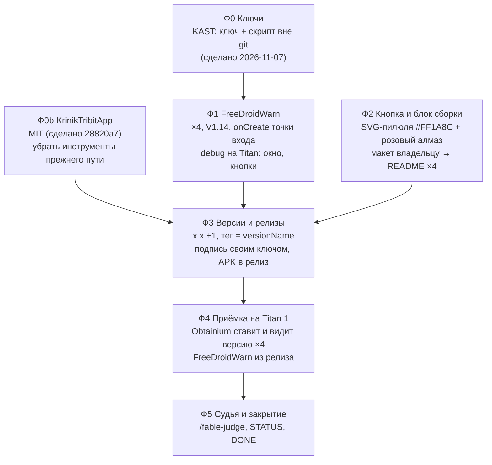

# 13 EPIC — Свобода дистрибуции: FreeDroidWarn + Obtainium + релизы x.x.+1

Слова владельца — `ideas/18_distribution_freedom_android_apps.md`. Разведка — `researches/05_distribution_freedom.md`.
Проекты: **KAST, KrinikCam, KARTUN, KrinikTribitApp** (клоны `D:\work\ai_sandbox\{KAST,KrinikCam,KARTUN,KrinikTribit}`).

## Вектор цели

Боль: Google с 2026/2027 требует личные данные разработчика для любых APK на сертифицированных устройствах; наши приложения
раздаются «скачай APK руками» без обновлений, а KrinikCam на GitHub подписан случайным debug-ключом CI.
Куда: каждое из четырёх приложений честно предупреждает пользователя (FreeDroidWarn), ставится и **само обновляется через
Obtainium** по одной розовой кнопке в README, подписано своим постоянным ключом, и README говорит, как собрать его самому.

## Критерии приёмки

- **К1** · Ситуация: на Titan 1 стоит релиз из GitHub · Действие: первый запуск · Результат: окно FreeDroidWarn на языке системы; OK — больше
  не показывается до следующего versionCode; «Подробнее»/«Решение» не роняют приложение · Проверка: снимок WebP + logcat без FATAL, ×4 приложения.
- **К2** · Ситуация: README проекта на GitHub · Действие: нажать розовую кнопку Obtainium на телефоне с Obtainium · Результат: Obtainium
  открывает карточку приложения с верными id/автором/именем и находит последнюю версию x.x.+1 · Проверка: снимок Obtainium на Titan, ×4.
- **К3** · каждый релиз: тег `vX.Y.Z` = `versionName` `X.Y.Z`; в релизе APK, подписанный своим ключом (`apksigner verify --print-certs`
  ≠ `CN=Android Debug`); versionCode больше прошлого релиза · Проверка: вывод apksigner + `gh release view`, ×4.
- **К4** · README каждого проекта: кнопка Obtainium в стиле `#FF1A8C` с розовым алмазом (EN и RU-раздел), блок «Как собрать» по одному
  шаблону · Проверка: макет показан владельцу до коммита; рендер README на GitHub снят.
- **К5** · ключи релиза вне git у всех четырёх (`git check-ignore`), копия у владельца · Проверка: вывод check-ignore.

## Фазы

Развилка по KrinikTribitApp решена владельцем 2026-11-07: «Предлагаю MIT» и «убрать» инструменты прежнего пути.

**Ф0b — что убирается из публичного KrinikTribitApp** (путь «патчить официальный APK»; отслеживаемые файлы на 2026-11-07):
`build.sh`, `patches/` (apply.py, add_dex.py, java/ ×8, assets/ ×3), `tools/recon/` (×18), `tools/gen_r.py`, `tools/kotlin_defaults.py`,
`tools/native_src_count.py`, `tools/native_src_guard.py`, `tools/decompile_clean.py`, `tools/test_decompile_clean.py`; ссылки на них в
README / HOUSE_RULES / картах проекта переписать. **Остаются** инструменты нового приложения: `tools/fetch_speaker_images.py` и
`tools/devices/` (каталог колонок и фото — решение владельца 2026-10-16 «зашиваем в наш апп»), `tools/screen_profile.py`, проверки.
Файлы уходят из дерева; в истории git они остаются (переписывать историю публичного репозитория — только по отдельному слову владельца).

Порядок и почему:
- **Ф0** первым: без ключа нет подписанного релиза (сделано: `KAST/keys/`, `tools/make-release-key.py`, подпись в `app/build.gradle`).
- **Ф1 и Ф2 независимы** (код приложений vs README) — идут параллельно; Ф2 упирается в показ макета владельцу (правило «интерфейс — до PR»).
- **Ф3 после Ф1 и Ф2:** релиз должен уже содержать FreeDroidWarn, а README — вести на него; кнопка Obtainium без релиза ведёт в пустоту.
- **Ф4** — на настоящих релизах, не на debug: проверяется именно то, что получит пользователь.

## Ворота

| Фаза | Вход | Закрытие |
|---|---|---|
| Ф1 | клоны чистые по нашим файлам | debug-сборка ×4 зелёная; на Titan окно показано, OK запомнен, «Подробнее»/«Решение» без падения; снимки WebP |
| Ф2 | бренд-цвета из разведки | владелец одобрил макет кнопки и блока; README ×4 закоммичены; рендер на GitHub проверен |
| Ф0b | слово владельца «убрать» | файлы прежнего пути не в `git ls-files`; debug-сборка KrinikTribitApp зелёная; ссылок на них в README нет |
| Ф3 | Ф0b, Ф1, Ф2 закрыты | релиз ×4: тег = versionName, APK подписан своим ключом (apksigner), versionCode вырос |
| Ф4 | релизы опубликованы | К1–К3 на Titan по каждому приложению, снимки |
| Ф5 | Ф4 | вердикт судьи VERIFIED, STATUS, `DONE` в имени файла |

## Скелеты фаз (операционный план пишется к началу фазы)

- **Ф1 FreeDroidWarn** — JitPack в репозитории (у KARTUN и KrinikTribit добавить), `implementation 'com.github.woheller69:FreeDroidWarn:V1.14'`,
  вызов в `onCreate`: KAST `PcView.java`, остальные `MainActivity.kt`; защитить от #45 (нет браузера); commit + push в каждый репозиторий.
- **Ф2 Кнопка и блок** — `docs/get-it-on-obtainium-{en,ru}.svg` (пилюля по образцу `KARTUN/docs/download-en.svg`, розовый алмаз, подпись
  источника и GPL-3.0 алмаза); глубокая ссылка с JSON приложения; шаблон блока «Как собрать»; макет — страница в новом окне Chrome на этой машине.
- **Ф3 Версии и релизы** — KAST 20.2.6→20.2.7 (code 58), KrinikCam 0.9→0.9.1 (`version.json`, CI больше не подписывает debug-ключом),
  KARTUN 1.0→1.0.1 (`versionName` чистый `1.0.1`), KrinikTribitApp 0.1→0.1.1 (code 2, первый релиз); сборка релиза своим ключом,
  `gh release create vX.Y.Z` с APK; имена APK под фильтр Obtainium.
- **Ф4 Приёмка** — Titan 1 по Wi-Fi: поставить Obtainium, по кнопке из README добавить каждое приложение, поставить, увидеть окно FreeDroidWarn.

## Риски

- KrinikCam: у тех, кто ставил 0.9 (debug-ключ CI), 0.9.1 поверх не встанет — разовая переустановка; сказать в заметках релиза.
- KARTUN: смена `versionName` с «1.0 (N)» на `1.0.1` убирает номер сборки из строки версии в приложении — номер остаётся в versionCode.
- KAST: четыре ABI-APK с одним versionCode — Obtainium без фильтра спросит, какой ставить; фильтр в глубокой ссылке.
- KAST на паузе (владелец 2026-11-06), но входит в список владельца — делаем.
- FreeDroidWarn #49: окно показывается и на системах без Google — принимаем как есть (текст библиотеки фиксирован).

## Решения, принятые без владельца

(заполняется по ходу и при закрытии эпика)

- Ключ KAST и пароль — в одной папке `keys/` (а не в корневом `.env`, где лежит PIN стенда), чтобы владелец копировал одну папку.
