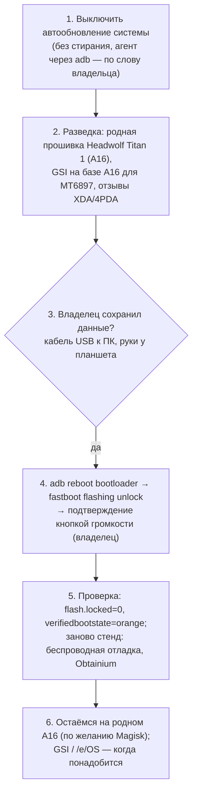

# Plan 18 — Titan 1: сохранить возможность прошивки до Android 17 (разблокировка загрузчика)

> **Created:** 2026-11-07 · **Status:** ⏸ записано, не начато — владелец: «давай это запишем в планы, пока дожмем мои Андроид проекты до релизов»
> · **Device:** HEADWOLF Titan 1 (`F8`), MediaTek Dimensity 8300 (`mt6897`, планшетное имя MT8792), Android 16
> (`BP2A.250605.031.A3`, патч 2026-05-05), wireless adb `192.168.1.3:<порт>`, adb только из SDK.

## Слова владельца (дословно, 2026-11-07)

> ты можешь по вай-фай проверить статус загрузчика в моем планшете?
>
> он разлочен?
>
> а как его разлочить?
>
> 8300
>
> режим для разработчиков включен у меня
>
> я включил
>
> проверь
>
> и какие хорошие есть загрузчики универсальные, чтобы его поставить?
>
> мне нужна возможность прошить устройство, если мой девайс обновится до Андроид 17 - и там будет все гуглом контролироваться
>
> давай это запишем в планы, пока дожмем мои Андроид проекты до релизов

## Состояние на 2026-11-07 ≈13:40 (прочитано через adb)

- Загрузчик **заблокирован**: `ro.boot.flash.locked=1`, `ro.boot.vbmeta.device_state=locked`, `ro.boot.verifiedbootstate=green`,
  `veritymode=enforcing`; сборка `user` / `release-keys`; `su` нет.
- Служба `oem_lock` есть; переключатель «Для разработчиков → **Разблокировка загрузчика**» владелец включил — на экране `checked=true`.
  Он только РАЗРЕШАЕТ разблокировку; сама разблокировка — `fastboot flashing unlock`.

## Вектор цели

Achieve: если Android 17 (или прошивка Headwolf) закроет устройство под контроль Google, владелец может поставить свою систему (GSI / без Google).
Maintain: данные владельца сохранены до стирания; путь назад (родная прошивка) есть. Avoid: потерять переключатель разблокировки после OTA.

Ключевой факт: верификация разработчиков Google касается установки приложений на СЕРТИФИЦИРОВАННЫХ устройствах; на загрузчик она не
распространяется. Риск — производитель новой прошивкой уберёт переключатель/запретит разблокировку. Уже разблокированный загрузчик
обновление само не заблокирует → разблокировать, пока переключатель есть.

## Варианты системы после разблокировки (кандидаты, проверить в разведке)

- **LineageOS GSI** (сборки AndyYan) — самый проверенный; с Google-сервисами и без.
- **crDroid GSI** — LineageOS + настройки.
- **/e/OS GSI** — без Google, microG.
- **TrebleDroid (AOSP, phh)** — голый Android, проверка «заводится ли GSI вообще».
- **Magisk** — рут на родной системе (патч загрузочного образа).
- GrapheneOS / CalyxOS — только Pixel, на Titan нельзя.

## Риски

- `fastboot flashing unlock` **стирает все данные**; откат блокировкой — тоже стирание.
- Play Integrity перестанет проходить (банки, Wallet, часть стримингов); при загрузке — предупреждение о разблокированном загрузчике.
- OTA от Headwolf могут перестать ставиться; гарантия.
- MediaTek: у Dimensity 8300 лазейка BROM (mtkclient) обычно закрыта — путь только через переключатель + fastboot; нужна родная прошивка для отката.
- Titan — тестовый стенд эпиков: после стирания стенд настраивается заново.
- fastboot по Wi-Fi не работает — нужен кабель USB к этому ПК.
