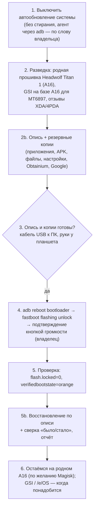

# Plan 18 — Titan 1: сохранить возможность прошивки до Android 17 (разблокировка загрузчика)

> **Created:** 2026-11-07 · **Status:** ⏸ записано, не начато — владелец: «давай это запишем в планы, пока дожмем мои Андроид проекты до релизов»
> · **Device:** HEADWOLF Titan 1 (`F8`), MediaTek Dimensity 8300 (`mt6897`, планшетное имя MT8792), Android 16
> (`BP2A.250605.031.A3`, патч 2026-05-05), wireless adb `192.168.1.3:<порт>`, adb только из SDK.

## Слова владельца (дословно, 2026-11-07)

> ты можешь по вай-фай проверить статус загрузчика в моем планшете?
>
> он разлочен?
>
> а как его разлочить?
>
> 8300
>
> режим для разработчиков включен у меня
>
> я включил
>
> проверь
>
> и какие хорошие есть загрузчики универсальные, чтобы его поставить?
>
> мне нужна возможность прошить устройство, если мой девайс обновится до Андроид 17 - и там будет все гуглом контролироваться
>
> давай это запишем в планы, пока дожмем мои Андроид проекты до релизов

> Это полностью сбросит прошивку? всё придётся по-новой настраивать?

> GSI или /e/OS, Это ОС, или загрузчики?

> у каких больше всего звезд, активности развития, контрибьютеров, сообщества?

> загрузчик есть смысл менять на другой?

> чемLineageOS так хороша в стравнении со стоковым Андроид?

> невозможно загрузчик так разлочить, чтобы не делать вайп?

> запиши в план, что нужно будет по максимуму востановить девайс до состаяния, которое было до вайпа

## Состояние на 2026-11-07 ≈13:40 (прочитано через adb)

- Загрузчик **заблокирован**: `ro.boot.flash.locked=1`, `ro.boot.vbmeta.device_state=locked`, `ro.boot.verifiedbootstate=green`,
  `veritymode=enforcing`; сборка `user` / `release-keys`; `su` нет.
- Служба `oem_lock` есть; переключатель «Для разработчиков → **Разблокировка загрузчика**» владелец включил — на экране `checked=true`.
  Он только РАЗРЕШАЕТ разблокировку; сама разблокировка — `fastboot flashing unlock`.

## Вектор цели

Achieve: если Android 17 (или прошивка Headwolf) закроет устройство под контроль Google, владелец может поставить свою систему (GSI / без Google).
Maintain: данные владельца сохранены до стирания; путь назад (родная прошивка) есть. Avoid: потерять переключатель разблокировки после OTA.

Ключевой факт: верификация разработчиков Google касается установки приложений на СЕРТИФИЦИРОВАННЫХ устройствах; на загрузчик она не
распространяется. Риск — производитель новой прошивкой уберёт переключатель/запретит разблокировку. Уже разблокированный загрузчик
обновление само не заблокирует → разблокировать, пока переключатель есть.

## Ответы агента владельцу (2026-11-07, для следующей сессии)

- Разблокировка стирает **данные**, не прошивку: Android 16 Headwolf остаётся, это как сброс к заводским настройкам.
- Без стирания разблокировать нельзя: ключи шифрования данных в защищённом модуле чипа привязаны к состоянию загрузчика — после разблокировки
  старые данные не расшифровать даже обходным путём; BROM-лазейка (mtkclient) на Dimensity 8300 как правило закрыта.
- Загрузчик НЕ меняют: preloader/LK MediaTek подписаны Headwolf и привязаны к железу — замена = кирпич, выигрыша нет; нужна только разблокировка родного.
- GSI — формат универсального образа СИСТЕМЫ (Project Treble); /e/OS — конкретная система без Google (выходит и как GSI). Загрузчиками они не являются.
- Сообщество на 2026-11-07 (живые цифры): LineageOS — 4 744 звезды манифеста, ≈163 контрибьютора, коммиты вчера (самое большое);
  crDroid — 718, ≈166, активно (поверх LineageOS); /e/OS — свой GitLab (звёзд мало по культуре GitLab), активно, за ним e Foundation/Murena;
  TrebleDroid (наследник phh, база всех GSI) — ≈134 контрибьютора, 2026-10-14; LineageOS GSI от AndyYan — 324 звезды, последний пуш 2026-01-26
  (проверить базу Android 16); phh treble_experimentations и ponces/treble_aosp — в архиве.
- LineageOS против стока: свои решения про Google (без него — не «сертифицировано», верификация Google не касается), годы ежемесячных патчей,
  нет мусора и телеметрии, запрет сети по приложениям; минусы — Play Integrity, Widevine L3 (стриминг в низком качестве), фирменные функции
  Headwolf, на Titan — только GSI (менее отполирована).

## Восстановление после стирания — ПО МАКСИМУМУ до состояния «как до вайпа» (слово владельца 2026-11-07)

Принцип: перед стиранием — **опись** всего, что есть на планшете; после — восстановление по описи и **сверка «было/стало»** построчно.
Что не восстановилось — список владельцу с причиной (например, пароли Wi-Fi без рута не выгружаются).

**До стирания (агент, по Wi-Fi adb; владелец — только там, где нужен его аккаунт/экран):**
- [ ] Опись приложений: `pm list packages -3 -i --show-versioncode` (имя, версия, кем установлено) + системные отключённые/включённые; снимки всех
      рабочих столов и папок (раскладка ярлыков и виджетов).
- [ ] APK приложений не из Play (наши сборки, сторонние): `adb pull` их `base.apk`/сплитов в `D:\Android\private\titan-backup\<дата>\apk\` (вне git).
- [ ] Файлы: `adb pull /sdcard/{DCIM,Pictures,Download,Documents,Movies,Music,…}` целиком в ту же папку; размер и число файлов — в опись.
- [ ] Настройки системы: `settings list system|secure|global` в файлы — эталон для сверки (язык, экран, жесты, разработчик, анимации, яркость,
      время отключения экрана); снимки ключевых экранов настроек.
- [ ] Резервное копирование Google включено и выполнено сейчас (владелец проверяет на экране «Резервное копирование → Создать копию»).
- [ ] Obtainium: «Import/export → Export» — файл списка приложений с настройками (KAST, KrinikCam, KARTUN, Krinik Tribit, Super Artemis…).
- [ ] Данные приложений, которые не попадут в копию Google: экспорт там, где приложение умеет (профили KrinikCam/ключи стримов, эквалайзеры
      Krinik Tribit — «Экспорт», настройки Super Artemis/KAST — список ПК и профилей снимками экрана); у остальных — снимки экранов настроек.
- [ ] Сети Wi-Fi: список SSID (`cmd wifi list-networks`) — пароли владелец вводит заново или они вернутся из копии Google.
- [ ] Сопряжения: Bluetooth-устройства (колонки Tribit и прочее) — список; ПК в Super Artemis/KAST — список адресов.
- [ ] Стенд: беспроводная отладка (порт), UI-агент и прочее из HOUSE_RULES → раздел стенда — список, что вернуть.

**После стирания:**
- [ ] Мастер настройки: аккаунт Google владельца → восстановление из копии (владелец).
- [ ] Режим разработчика, беспроводная отладка, сопряжение с этим ПК (владелец разрешает на экране) → агент продолжает по Wi-Fi.
- [ ] Obtainium (с GitHub-релиза) → «Import» файла списка → наши приложения ставятся сами.
- [ ] APK из описи, которых нет в Play/Obtainium, — `adb install-multiple`.
- [ ] Файлы обратно `adb push`; настройки системы — по эталону (`settings put` для безопасных ключей, остальное руками по снимкам).
- [ ] Данные приложений — импорт экспортов; ПК в Super Artemis/KAST — пересопряжение; Bluetooth — пересопряжение колонок.
- [ ] Рабочие столы — по снимкам.
- [ ] Сверка: опись «до» против «после» (пакеты, версии, файлы, ключи настроек) → отчёт `testcases/reports/<дата>_titan-restore.md`
      с пунктами «восстановлено / не восстановлено, почему».

## Варианты системы после разблокировки (кандидаты, проверить в разведке)

- **LineageOS GSI** (сборки AndyYan) — самый проверенный; с Google-сервисами и без.
- **crDroid GSI** — LineageOS + настройки.
- **/e/OS GSI** — без Google, microG.
- **TrebleDroid (AOSP, phh)** — голый Android, проверка «заводится ли GSI вообще».
- **Magisk** — рут на родной системе (патч загрузочного образа).
- GrapheneOS / CalyxOS — только Pixel, на Titan нельзя.

## Риски

- `fastboot flashing unlock` **стирает все данные**; откат блокировкой — тоже стирание.
- Play Integrity перестанет проходить (банки, Wallet, часть стримингов); при загрузке — предупреждение о разблокированном загрузчике.
- OTA от Headwolf могут перестать ставиться; гарантия.
- MediaTek: у Dimensity 8300 лазейка BROM (mtkclient) обычно закрыта — путь только через переключатель + fastboot; нужна родная прошивка для отката.
- Titan — тестовый стенд эпиков: после стирания стенд настраивается заново.
- fastboot по Wi-Fi не работает — нужен кабель USB к этому ПК.
