Closes #14.

## What changes

The **Custom Resolution** row no longer opens a text field split on a Latin "x". It opens a dialog:

- **Aspect ratio:** five equal buttons — Native, 16:9, 16:10, 21:9, 4:3. Each button holds a rectangle of its own shape with the ratio written in it; Native takes the shape of the device screen.
- **Size:** minus, two number fields with a fixed ×, plus. The fields take digits only and open the number keyboard. Minus and plus move one stop.
- **Stops:** a bar of the selected ratio's stops with labels under it; the current stop's label is bold. A tap or a drag on the bar lands on a stop; a size typed by hand stands between the two nearest stops.
  - Native: 25%, 50%, 75%, 100% of the device screen, rounded to a multiple of 8.
  - 16:9: 720p, 900p, 1080p, 1440p, 4K · 16:10: 800p … 2400p · 21:9: 720p … 2160p · 4:3: 720p … 1440p.
- **Validation:** OK is disabled while a field is empty, a value is odd, a value is outside 256…8192, or the device decoders report the size as unsupported (`MediaCodecInfo.VideoCapabilities.isSizeSupported`). The fields turn red and one line under the bar names the reason.
- **Storage:** the result is saved as `WxH` in `edit_diy_w_h`, as before. The resolution picker, profiles and the stream read it unchanged.
- **Layout:** one column everywhere. On a compact-height window (a phone in landscape, height < 480 dp) the parts are a little smaller so the whole dialog fits without scrolling.
- **Row summary:** "Add a custom resolution, separated by x…" is replaced by "Pick an aspect ratio and a size, or type your own width and height…".

## Screenshots

| | | |
|---|---|---|
| 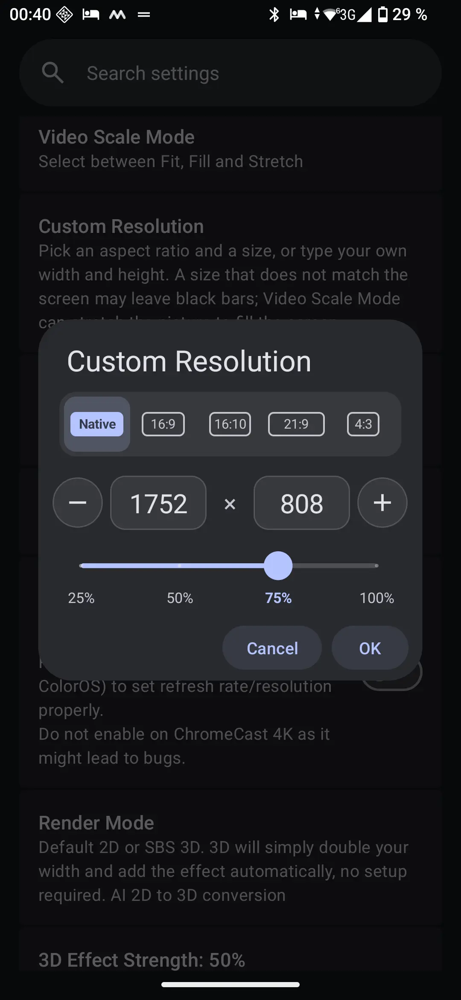 Galaxy S24 Ultra | 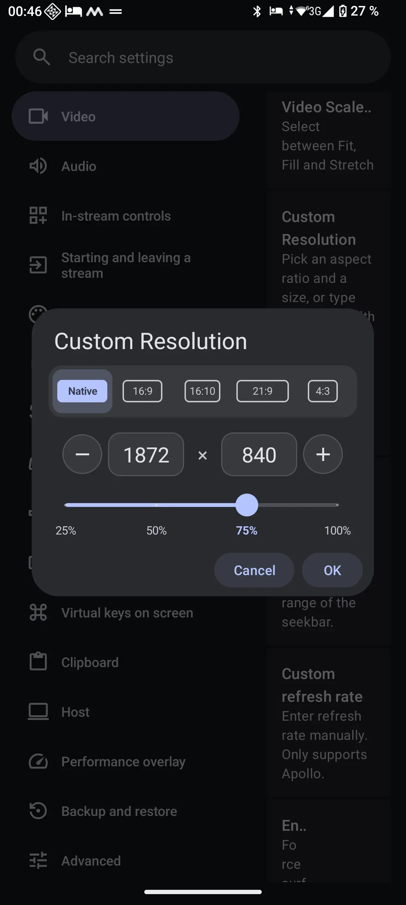 Pixel 9 Pro | 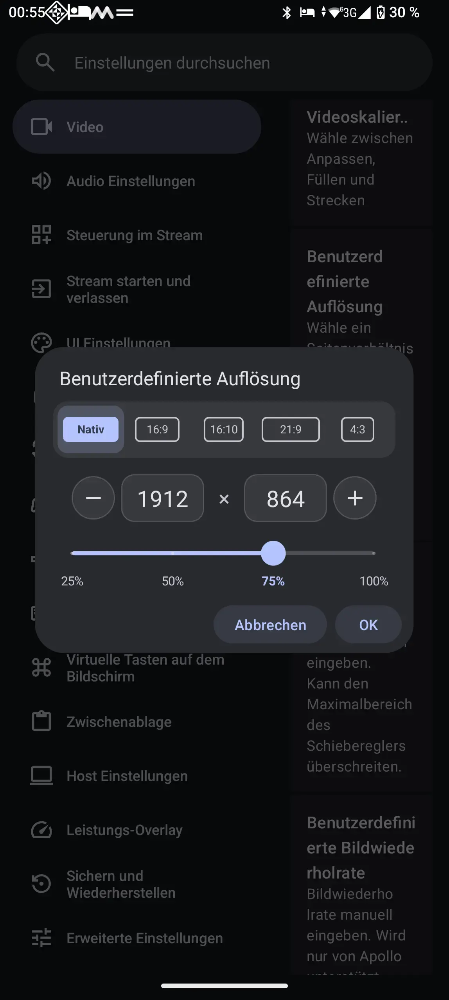 Motorola Edge 50 Pro (Deutsch) |
| 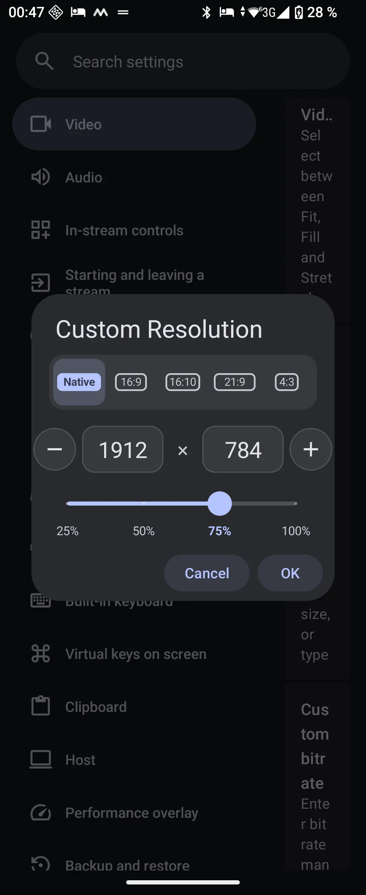 Galaxy Z Flip6 | 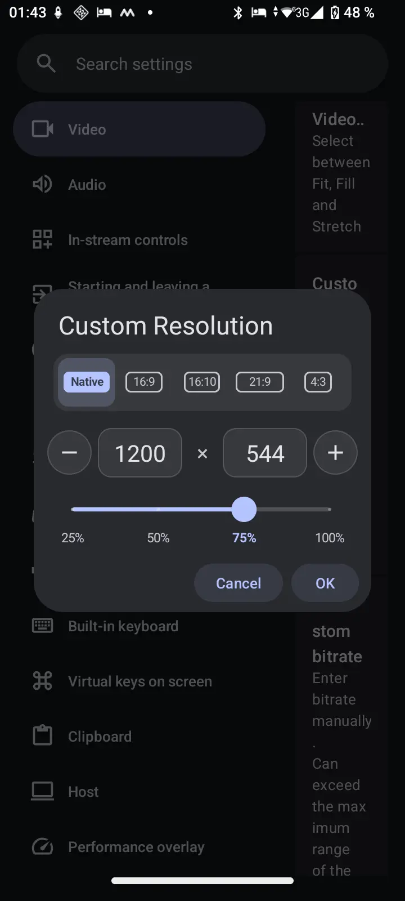 Galaxy A03 | 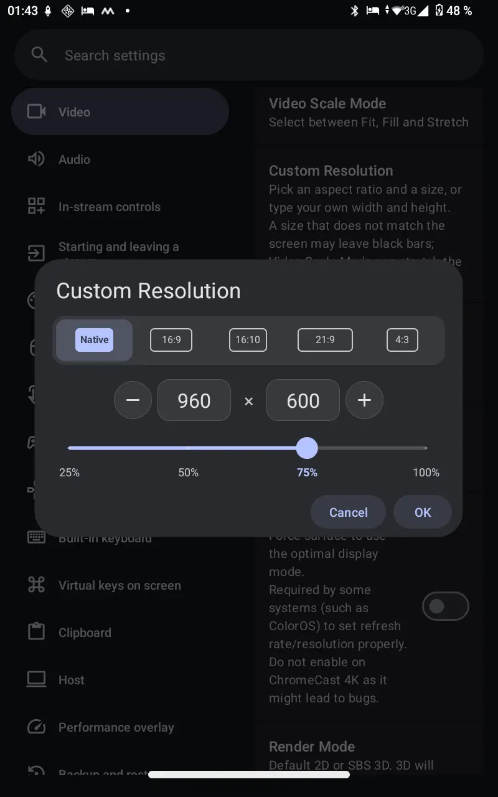 Teclast P85T |

Phones in landscape:

| | |
|---|---|
| 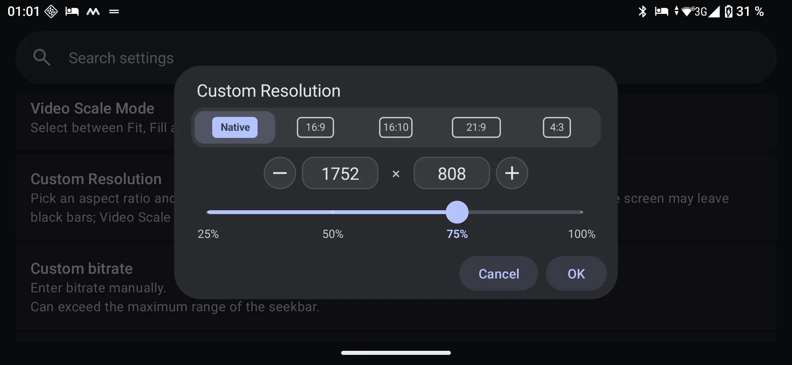 Galaxy S24 Ultra | 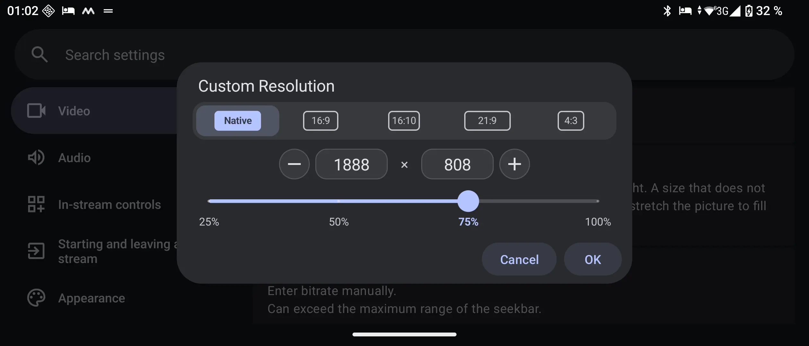 Xperia 10 V |
| 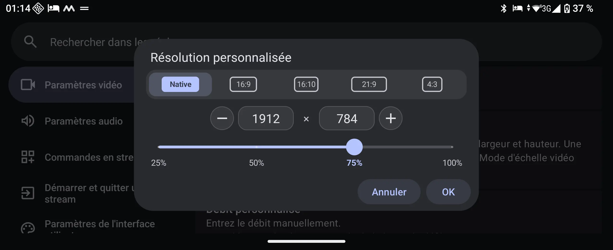 Galaxy Z Flip6 (Français) | |

Tablets and foldables:

| | |
|---|---|
| 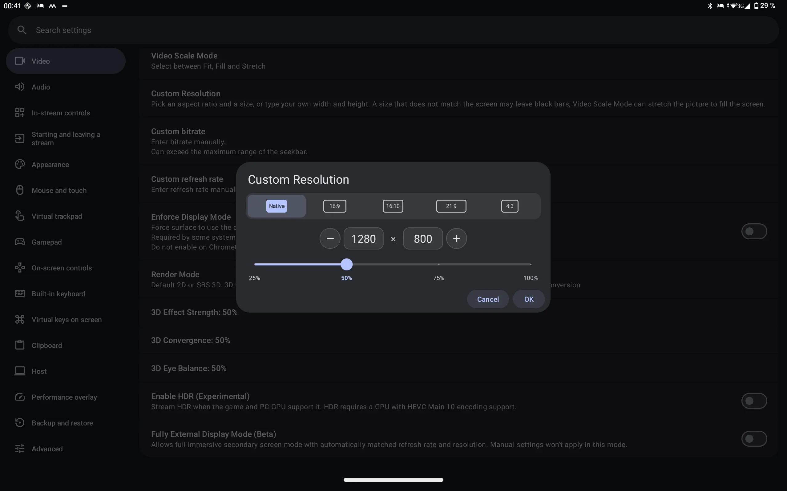 Galaxy Tab S10 Ultra | 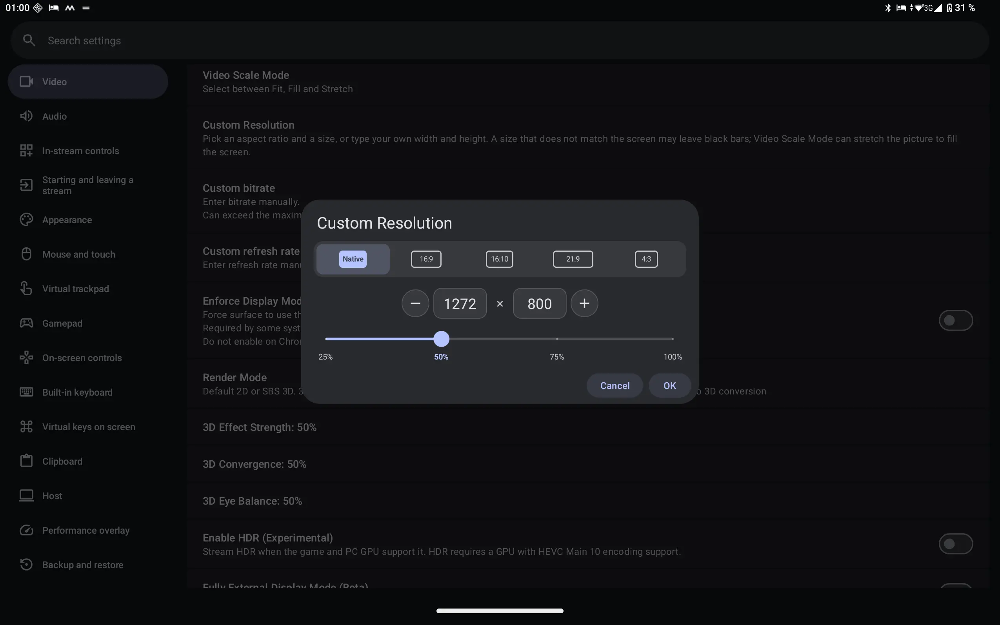 Lenovo Tab Extreme |
| 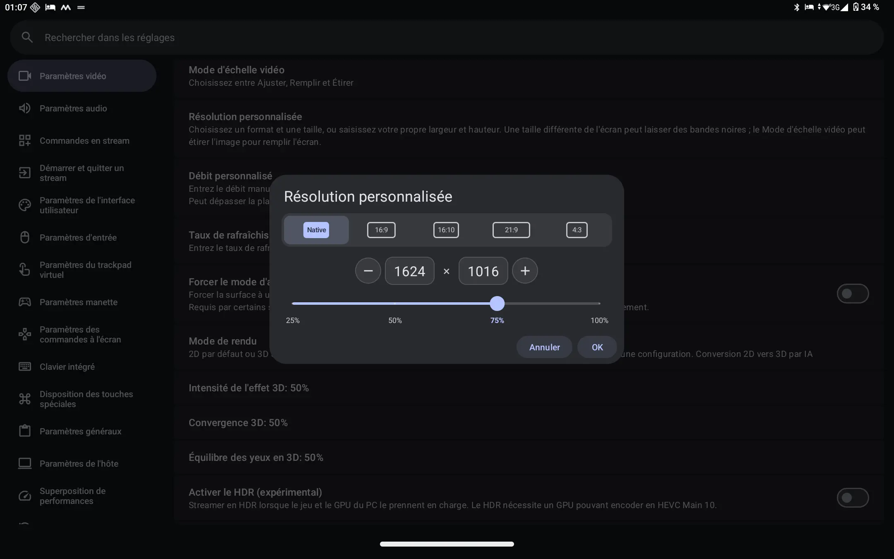 Lenovo Yoga Tab 13 (Français) | 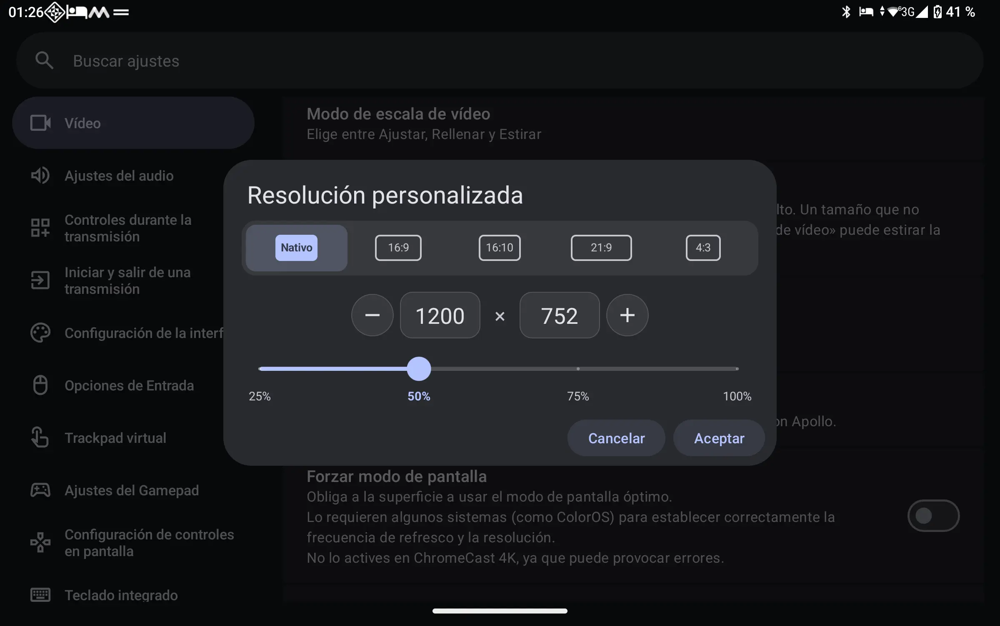 RedMagic Astra (Español) |
| 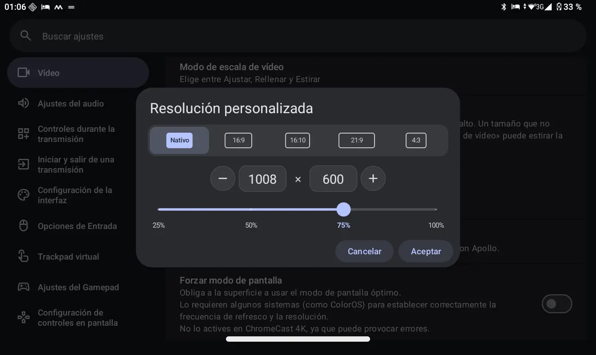 Galaxy Tab A7 Lite (Español) | 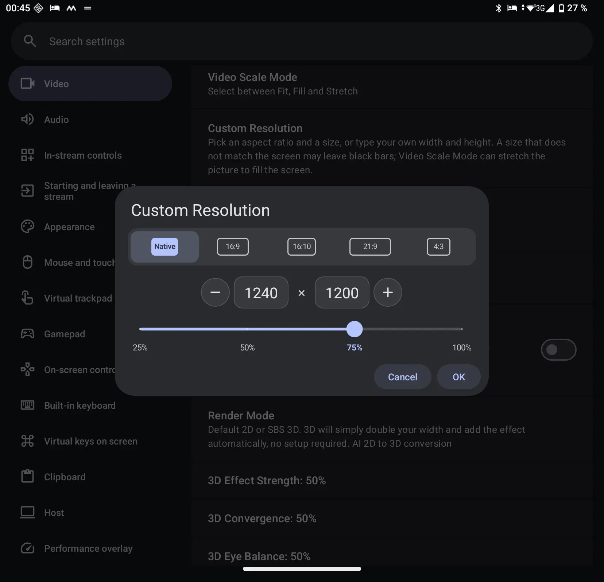 Pixel 9 Pro Fold (inner) |
| 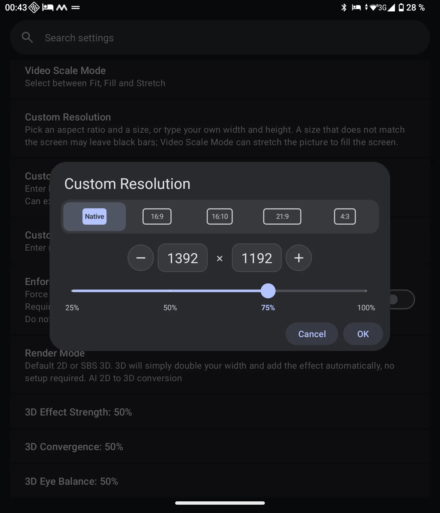 Galaxy Z Fold6 (inner) | 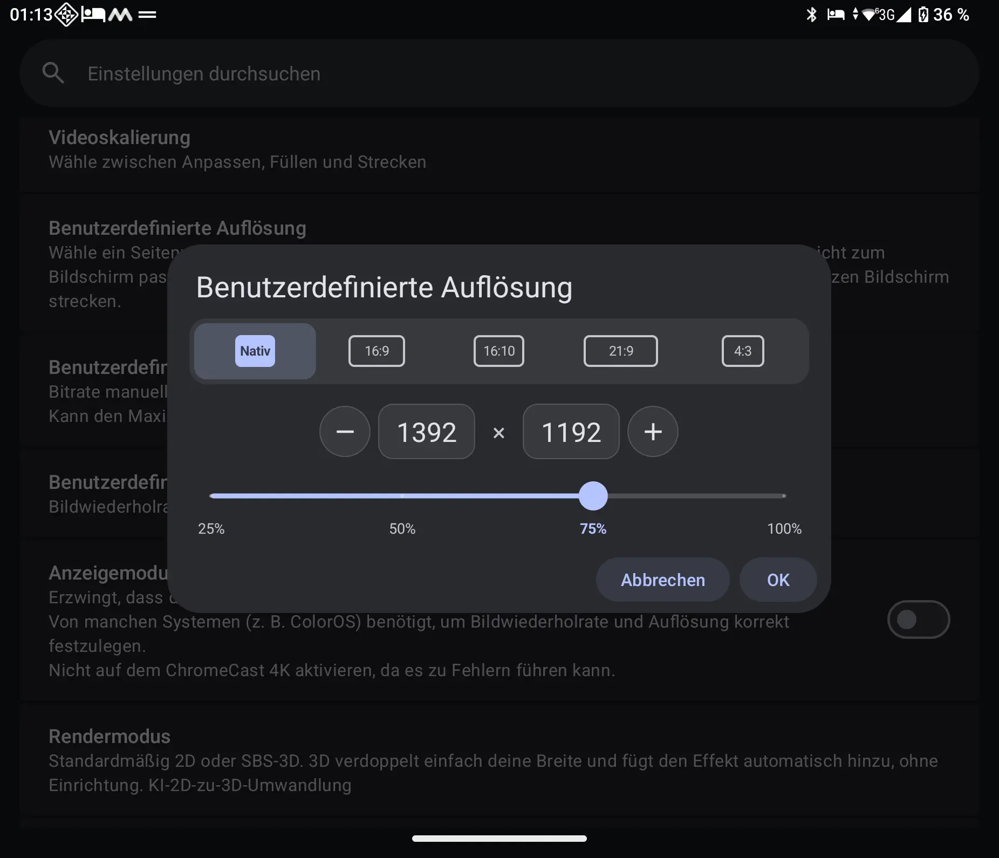 Galaxy Z Fold6 (inner, Deutsch) |

### Screenshots list

| Device | Screen | Orientation | Language |
|---|---|---|---|
| Galaxy S24 Ultra | 1080×2340, 450 dpi | portrait, landscape | English |
| Pixel 9 Pro | 1280×2856, 480 dpi | portrait | English |
| Motorola Edge 50 Pro | 1220×2712, 450 dpi | portrait | Deutsch |
| Galaxy Z Flip6 (inner) | 1080×2640, 480 dpi | portrait / landscape | English / Français |
| Galaxy A03 | 720×1600, 300 dpi | portrait | English |
| Teclast P85T | 800×1280, ≈234 dpi | portrait | English |
| Xperia 10 V | 1080×2520, 450 dpi | landscape | English |
| Galaxy Tab S10 Ultra | 1848×2960, 300 dpi | landscape | English |
| Lenovo Tab Extreme | 1876×3000, 320 dpi | landscape | English |
| Lenovo Yoga Tab 13 | 1350×2160, 240 dpi | landscape | Français |
| RedMagic Astra | 1504×2400, ≈388 dpi | landscape | Español |
| Galaxy Tab A7 Lite | 800×1340, 213 dpi | landscape | Español |
| Pixel 9 Pro Fold (inner) | 2076×2152, 390 dpi | landscape | English |
| Galaxy Z Fold6 (inner) | 1856×2160, 420 dpi | portrait / landscape | English / Deutsch |

## Implementation

- `CustomResolutionModel` — plain Java, no Android classes: the stops of each ratio, the ratio a saved size opens on, the position of a typed size between stops, minus and plus, validation, and parsing of a saved value with any separator (`x`, `X`, `×`, Cyrillic `х`, spaces).
- `ResolutionStopsBar` — the bar with labelled stops. A `SeekBar` cannot place its thumb between ticks or draw labels; the thumb is the same 24 dp circle as in the other slider dialogs, and the end labels stop on the dialog's text line.
- `CustomResolutionPreference` — the row and its dialog; it reuses `StepperViews` for the minus, field and plus row and the dialog buttons.
- `preferences.xml` — the `edit_diy_w_h` row uses `CustomResolutionPreference`; `StreamSettings` keeps only the reload after a save (the dialog validates the size itself).

## Tests

- New `CustomResolutionModelTest` (8 tests): native stops rounded to 8, the ratio a saved size opens on, a typed size between stops, minus and plus, switching ratio keeps the height, validation, parsing with any separator.
- The whole unit suite: 530 of 532 pass; the two failures are `BackupRestoreTest` cases that fail on a Windows build machine regardless of this change.

## Strings

Four validation reasons (`custom_resolution_error_*`) and the new `summary_custom_resolution` for every locale that translates the Custom Resolution row (21 locales). `dialog_custom_resolution` is no longer shown by this row.

🤖 Generated with [Claude Code](https://claude.com/claude-code)
