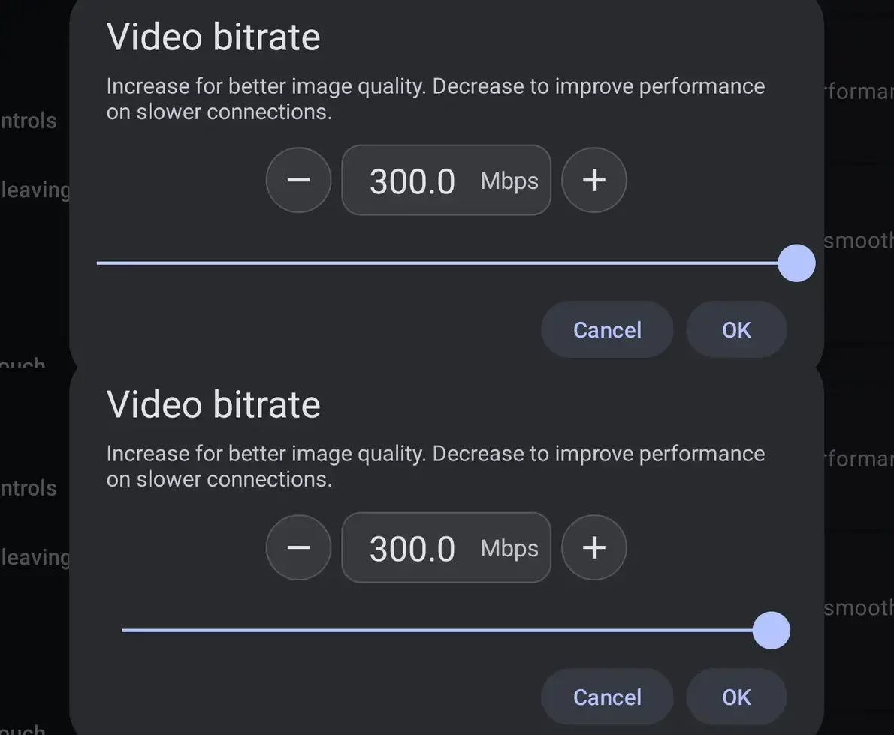
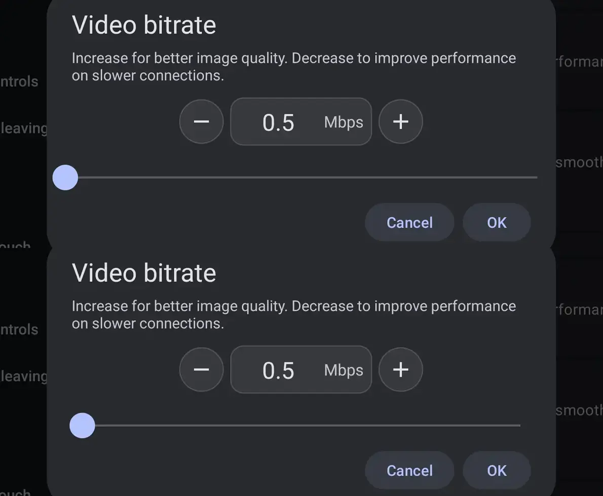

## What changes

The slider bar in the setting dialogs built on `SeekBarPreference` (bitrate, resolution scale, trackpad and touch sensitivity, deadzone, on-screen controls opacity, network grace time and the others) ran from one dialog edge to the other. With the value at the minimum or the maximum, the thumb stood about 6 dp from the dialog edge.

The bar now has a 16 dp margin on both sides (`StepperViews.barParams`). At the minimum the thumb stops on the line of the title and description text; at the maximum it stops on the line of the OK button.

## Screenshots

Video bitrate dialog, before (top) and after (bottom). HEADWOLF Titan 1, 2560×1600, 480 dpi, landscape.

Maximum, 300 Mbps:

Minimum, 0.5 Mbps:

## Scope

One method, `StepperViews.barParams`, and one constant. Every slider dialog that uses it gets the same inset; nothing else in the dialogs moves.

🤖 Generated with [Claude Code](https://claude.com/claude-code)
