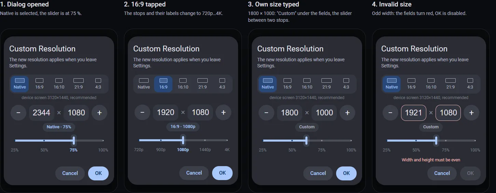
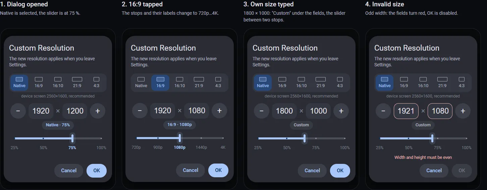

## Context

Thank you for merging PR #13. You replaced its resolution dialog with the sectioned picker (`dec0ca54`), and the picker keeps the standard, native and custom entries one tap away. This proposal covers the Custom Resolution row, the one place in Settings where a size is typed. A size saved there shows up in the Custom Resolution section of the picker.

## Problem

The Custom Resolution row opens a plain text field (`edit_diy_w_h`, `InputType.TYPE_CLASS_TEXT`). The change listener in `StreamSettings.java` splits the value with `value.split("x")`, so the size has to be typed as `1920x1080` with a Latin "x". The text field and the split cause three problems:

1. The field opens the letter keyboard for a value that holds only digits and a separator.
2. On a Cyrillic layout the key in the Latin "x" position types "х" (U+0445). The listener then gets one segment and shows "An error occurred". A "×", an "X" or a space as the separator also ends in this error.
3. To fill a phone screen that is not 16:9 (19.5:9, 20:9), the user calculates a size with the screen's ratio by hand. moonlight-android PR #1349 added custom resolutions for this case: its author scaled a 20:9 2400×1080 phone down to 1920×864 to keep the full screen.

## Proposal

The Custom Resolution dialog gets an aspect ratio row, a minus button, two number fields with a fixed ×, a plus button and a slider with labelled stops of the selected ratio.

Galaxy S24 Ultra, 3120×1440 (19.5:9):

HEADWOLF Titan 1, 2560×1600 (16:10):

Interactive mockup, where every control responds and a switch changes the device: https://htmlpreview.github.io/?https://github.com/MikalaiKryvusha/KAST/blob/moonlight-noir/reports/sa-sliders/custom_resolution_v3_en.html

How the dialog behaves:

1. **Aspect ratio row:** Native, 16:9, 16:10, 21:9, 4:3. Each segment carries a small frame of its shape. The line under the row names the device screen and marks it as recommended. The dialog opens on the ratio of the saved size; a saved size that matches no ratio opens on Native.
2. **Fields:** width and height take digits only and open the number keyboard. The × between the fields is a label and cannot be erased.
3. **Slider:** the stops belong to the selected ratio and are labelled under the track.
   - Native: 25%, 50%, 75%, 100% of the device screen, each size rounded to a multiple of 8.
   - 16:9: 720p, 900p, 1080p, 1440p, 4K.
   - 16:10: 800p, 900p, 1200p, 1600p, 2400p.
   - 21:9: 720p, 1080p, 1440p, 2160p.
   - 4:3: 720p, 900p, 1080p, 1440p.

   Minus and plus move one stop, and a tap on a label moves to that stop. The chip under the fields names the stop, for example "Native · 75%" or "16:9 · 1080p".
4. **Typed size:** a size typed by hand shows "Custom" in the chip, the ratio row keeps its selection, and the slider stands between the two nearest stops.
5. **Validation:** OK is disabled while a field is empty, either value is odd, a value is outside 256…8192, or the phone's decoder reports the size as unsupported (`MediaCodecInfo.VideoCapabilities.isSizeSupported`). The fields turn red, and one line under the slider names the reason.
6. **Storage:** the result is saved as `WxH` in `edit_diy_w_h`. The picker, profiles and the stream code read `edit_diy_w_h` unchanged.

## Why this design

- **Two number fields with a fixed separator are the pattern of Moonlight PC (moonlight-qt).** Its Custom resolution dialog has a width field, an "x" label and a height field, accepts digits only in 256…8192 and keeps OK disabled while the input is invalid: [SettingsView.qml](https://github.com/moonlight-stream/moonlight-qt/blob/master/app/gui/SettingsView.qml).
- **The aspect ratio comes first, the size second.** RetroArch sets the aspect ratio and then the custom viewport width and height ([libretro forum](https://forums.libretro.com/t/how-to-make-the-retroarch-window-larger-than-my-monitor/30582)). Game settings menus filter resolutions by aspect ratio ([gamedev.net](https://gamedev.net/forums/topic/712586-choose-video-game-resolutions-for-graphics-settings-ie-provide-choices-for-the-user/), [Unreal forum notes on video settings UX](https://forums.unrealengine.com/t/my-notes-on-improving-your-typical-video-settings-screen-ui-ux/260500)).
- **Native is the default and marked as recommended**, as Windows marks the native mode in its display settings ([Microsoft Support](https://support.microsoft.com/en-us/windows/change-your-screen-resolution-and-layout-in-windows-5effefe3-2eac-e306-0b5d-2073b765876b)). The other ratios stay one tap away.
- **The slider gives a coarse choice; the fields then hold the exact value.** Material guidance pairs a slider with an editable field when the exact value matters ([Material sliders](https://m2.material.io/components/sliders)). Segmented buttons hold two to five options ([segmented button](https://developer.android.com/develop/ui/compose/components/segmented-button)), and five ratios fit. Material Slider tick marks carry no labels and are thinned when dense ([TickVisibilityMode](https://developer.android.com/reference/com/google/android/material/slider/TickVisibilityMode)), so the dialog draws its own labels and keeps at most five stops per ratio.
- **Even sizes, multiples of 8 on the slider.** 4:2:0 chroma subsampling halves both dimensions of the picture, so the encoder needs an even width and height. H.264 codes 16×16 blocks, so 1080 is coded as 1088 and cropped ([VideoHelp](https://forum.videohelp.com/showthread.php?p=2341340)); NVENC HEVC codes 2160 as 2176 ([NVIDIA forum](https://forums.developer.nvidia.com/t/nvenc-hevc-encoding-of-3840x2160-results-in-coded-size-of-3840x2176/60107)). Android reports the sizes a decoder supports through `MediaCodecInfo.VideoCapabilities` ([VideoCapabilities](https://developer.android.com/reference/android/media/MediaCodecInfo.VideoCapabilities)), and the dialog uses that check before OK.
- **A share of the native screen lowers the decode and network load and keeps the full screen.** 75% of a 3120×1440 screen is 2344×1080: the picture keeps the screen's own ratio, and the user calculates nothing.

## Scope

One dialog, opened from the Custom Resolution row. The sectioned picker, its native entries and the stream code stay as they are. The ratio labels need no translation; the new lines (the recommended screen line and four validation messages) come with translations for every `values-*` locale. The minus, field and plus row reuses `StepperViews`, merged with PR #13.

## Questions

1. Does this direction work for the Custom Resolution row?
2. The ratio set is Native, 16:9, 16:10, 21:9, 4:3. Would you add or remove any?

If you agree, we will open a separate PR, tested on HEADWOLF Titan 1 (16:10) and Galaxy S21 FE (19.5:9). The S24 Ultra in the screenshots is the device from your PR #13 reply; the S21 FE has the same 19.5:9 ratio.
